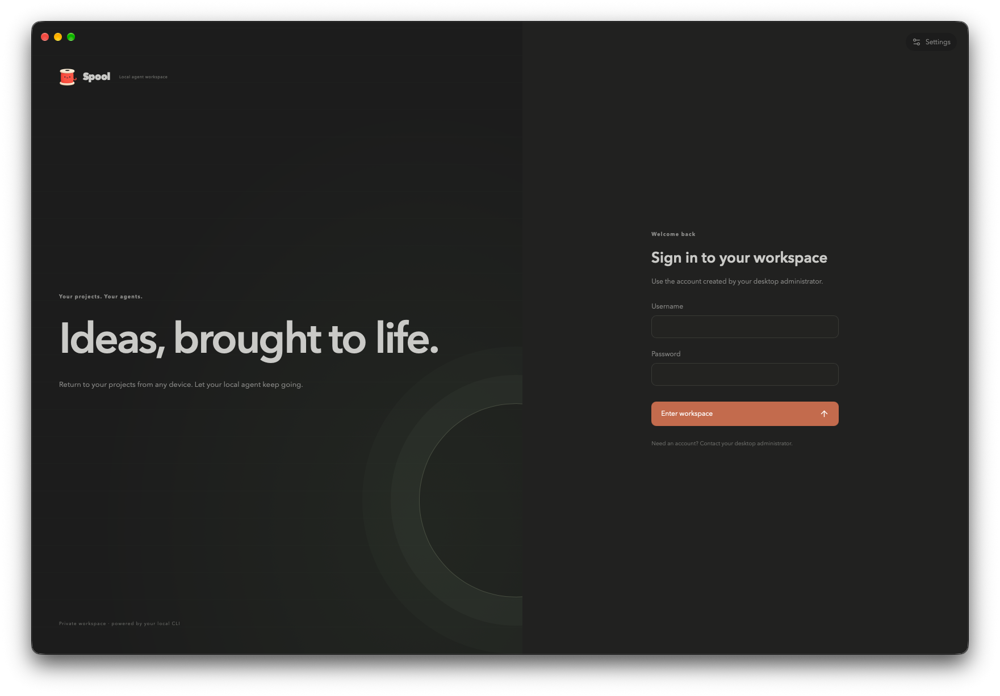
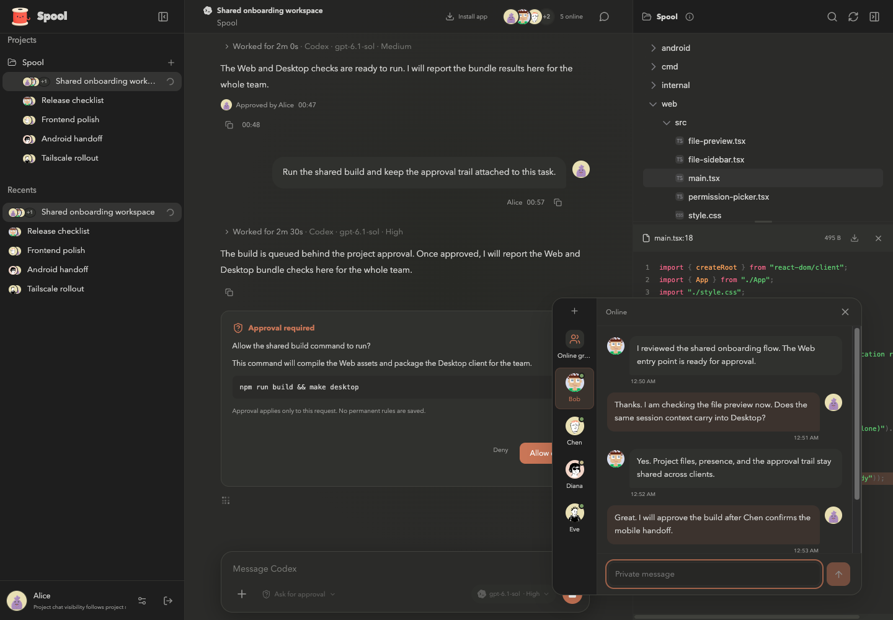

<div>
  <h1>Spool</h1>
</div>

[简体中文](README.zh-CN.md)

> Spool is a multi-platform, multi-user workspace for local AI coding. It brings
Desktop, Web/PWA, and Android clients into one shared project and chat space,
so a team can work together from different devices with the same permissions,
presence, and project context.



Tasks and code execution run on the machine hosting the service. Project
directories, native CLI sessions, and provider login data stay with the tools
on that machine. Team members connect to that service through the clients above;
Spool is not a hosted model service. Install and sign in to Codex or Claude Code
on the service host before use.

## Features

### Multi-platform workspace

- Use one Spool service from the Desktop app, a browser/PWA, or the native Android client.
- Continue the same projects and chats across devices without copying the working directory or provider sessions.
- Use embedded Tailscale HTTPS or a trusted reverse proxy when the service needs to be reached remotely.

### Multi-user collaboration

- Invite people to projects with separate personal-session and shared-session permissions.
- See online presence, exchange private messages, and use online or selected-member group chats.
- Share project context with explicit project membership, session management, and file access.

### Local AI coding workspace

- Supports Codex and Claude Code, including each CLI's available models, reasoning levels, and permission modes.
- Uses an independent native CLI session for every chat, with streaming output, stop, resume, and idle release.
- Renders Markdown, code, diffs, tool activity, images, and file attachments; browse project files and Git worktrees directly.
- Supports the native `/goal` command and per-request approval for commands, files, and additional permissions.
- Saves agent, model, and permission selections per chat while keeping history in the native Codex or Claude session.

### Projects and permissions

- Organizes working directories, sessions, members, and agent settings by project; data is stored in local SQLite.
- Separates user, project-member, personal-session, and shared-project-session permissions.
- Binds file access to the project directory so remote requests cannot choose an arbitrary working directory.
- Provides authorized workspace file browsing, Markdown/HTML previews, source viewing, and limited external-file references.
- Projects expose the service host's actual files and operating-system permissions, so access should be granted only to trusted users.

### Presence and notifications

- User avatars, presence, theme, and language preferences across supported clients.
- Desktop system notifications and Web Push without prompts, replies, or project names in notification bodies.
- English, Simplified Chinese, and Japanese, with system theme and language support.

### Automation and remote access

- Scheduled GitHub Issue processing with Codex or Claude in isolated worktrees, producing PRs targeting `dev`.
- A headless Go server for a continuously running development machine or server.
- An optional embedded Tailscale (`tsnet`) HTTPS entry for Android and remote browsers on the tailnet.
- Optional [voxl](https://github.com/tembo/voxl) remote desktop, started on demand and granted per user by an administrator.



## Development and build

### Requirements

- Go **1.27.3** or newer.
- Node.js **22.12** or newer, plus npm.
- Codex CLI or Claude Code installed and signed in on the service host. They are optional for frontend-only work and tests that do not use an agent.
- Android development requirements are listed in the [Android documentation](android/README.md).

MyGo is pinned to `v0.6.4`. Frontend dependencies are installed in
`web/node_modules/`; production frontend assets are embedded in the Desktop and
server binaries.

### Local development

Run from the repository root:

```sh
(
  set -eu
  REPO_ROOT="$(git rev-parse --show-toplevel)"
  cd "$REPO_ROOT"
  export GOCACHE="$REPO_ROOT/build/cache/go-build"
  mkdir -p "$GOCACHE"
  make dev
)
```

`make dev` installs and builds the Web assets, then starts the MyGo development
Desktop and Vite hot reload. Go changes rebuild the application; frontend
changes use HMR. The default service port is `127.0.0.1:8787`, and the Vite
development port is `127.0.0.1:5173`.

For browser-only development, run the backend and Vite in separate terminals:

```sh
# Terminal 1
GOCACHE="$PWD/build/cache/go-build" go run ./cmd/server

# Terminal 2
npm --prefix web run dev
```

Vite proxies `/api` to `127.0.0.1:8787`. Use the Go-served address when checking
PWA installation, Service Worker updates, or offline behavior.

### Build and test

```sh
# Install dependencies and build embedded frontend assets
GOCACHE="$PWD/build/cache/go-build" make web

# Build unbundled Desktop and headless server binaries
GOCACHE="$PWD/build/cache/go-build" make desktop
GOCACHE="$PWD/build/cache/go-build" make server

# Build MyGo desktop packages
GOCACHE="$PWD/build/cache/go-build" make package

# Frontend tests, Go race tests, and go vet
GOCACHE="$PWD/build/cache/go-build" make test
```

Build output is placed in `build/`. `make desktop` creates
`build/spool-desktop`, `make server` creates `build/spool-server`, and
`make package` creates platform-specific desktop applications and installers.
Tests use local mock CLIs and do not call a model for inference.

### Repository layout

- `cmd/desktop`: MyGo Desktop entry point, tray, native settings, and desktop notifications.
- `cmd/server`: headless Go server entry point.
- `internal/agent`: Codex/Claude CLI lifecycle, protocols, and session handling.
- `internal/workspace`: SQLite, authentication, project permissions, chat, presence, and service lifecycle.
- `web`: React/TypeScript Web and PWA client.
- `android`: native Android client and gomobile boundary.
- `frontend`: build-generated Web assets embedded in the Go binaries.

## Running the service

Development runs use `~/.spool-dev` by default; production builds use `~/.spool`.
The database is stored at `db/spool.sqlite` inside the selected data directory.
Use `-data-dir` or `SPOOL_HOME` to select another data directory. Only one
Desktop or server instance can own a data directory at a time.

Before starting a headless server, create the initial user and project while the
service is stopped:

```sh
SPOOL_NEW_PASSWORD='replace-with-a-long-unique-password' \
  ./build/spool-server -add-user alex -nickname Alex

./build/spool-server -add-project Example \
  -directory /absolute/project/path -grant alex

./build/spool-server -host 127.0.0.1 -port 8787
```

Chat and management APIs require an enabled account. The service does not
provide a default password, remote sign-up, or remote administration API.

### Web/PWA and HTTPS

For local access, open `http://127.0.0.1:8787`. To use a browser on another
device or install the PWA, access Spool through HTTPS and configure the exact
same Public origin in Desktop settings or the server configuration. For example,
with Caddy:

```caddyfile
chat.example.com {
    reverse_proxy 127.0.0.1:8787 {
        flush_interval -1
    }
}
```

The reverse proxy must support WebSocket upgrades and long-lived SSE connections,
and should disable response buffering. Spool still enforces login cookies, CSRF,
Origin, and project permission checks.

### Tailscale and Android

Enable embedded Tailscale in **Service > Tailscale (tsnet)** in Desktop, or run
the following with the headless server:

```sh
./build/spool-server -tsnet -tsnet-hostname spool-server
```

The first setup requires MagicDNS and HTTPS certificates in the Tailscale admin
console, followed by node login or approval. The server prints its actual HTTPS
address after startup; enter that complete address in the Android client. The
Tailscale entry still requires Spool login and does not bypass project permissions
or CSRF checks.

## Remote desktop (voxl)

voxl is an optional remote desktop component managed separately from project
permissions. A user sees **Connect to desktop** only after voxl has been installed
and enabled locally and an administrator has granted that user's remote desktop
permission. voxl starts when a viewer connects and stops after the last viewer
disconnects. Remote desktop can control the service host's full desktop, including
Spool settings, so grant it only to trusted users.

You can import an existing voxl binary or let Spool build a pinned
`voxl-server` version:

```sh
# Import an existing local voxl binary
./build/spool-server -install-voxl \
  -voxl-binary /absolute/path/to/voxl

# Grant or revoke remote desktop access for a user
./build/spool-server -remote-desktop-user alice \
  -remote-desktop=true

# Enable remote desktop
./build/spool-server -remote-desktop=true
```

Without `-voxl-binary`, Spool first searches for a local executable and then
builds `voxl-server` **0.3.3** from crates.io when needed. The native prerequisites
vary by platform: macOS needs Xcode Command Line Tools and Rust; Linux needs
X11/Xvfb, Rust, x264, libyuv, Opus, and PulseAudio libraries; Windows needs Rust
MSVC, Visual Studio C++ Build Tools, LLVM, and vcpkg. macOS also requires Screen
Recording and Accessibility permission for Spool or voxl.

Remote desktop uses the existing Spool HTTPS/Tailscale entry, while the voxl
helper listens only on loopback. Its file panel uses `<data-dir>/voxl/shared/`;
uploads and downloads remain protected by Spool login, remote desktop grants,
Origin, and CSRF checks. See the [voxl upstream instructions](https://github.com/tembo/voxl#usage) for platform dependencies.

## voxl copyright and licensing

Spool integrates [voxl](https://github.com/tembo/voxl), whose source code is
licensed under the [MIT License](https://github.com/tembo/voxl/blob/main/LICENSE).
The [x264](https://www.videolan.org/developers/x264.html) library used by voxl
is licensed under [GPLv2 or later](https://www.gnu.org/licenses/old-licenses/gpl-2.0.html);
builds linked with x264 must comply with the applicable GPL terms. Other
dependencies retain their respective licenses.

Installing or building voxl locally does not remove these obligations. If you
redistribute binaries containing voxl or x264, assess and provide the applicable
license notices, copyright information, and corresponding source code.
