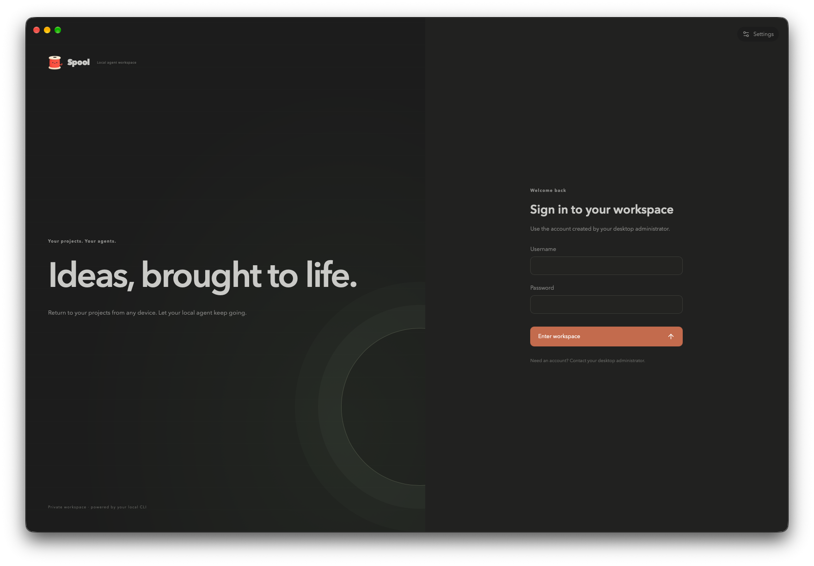
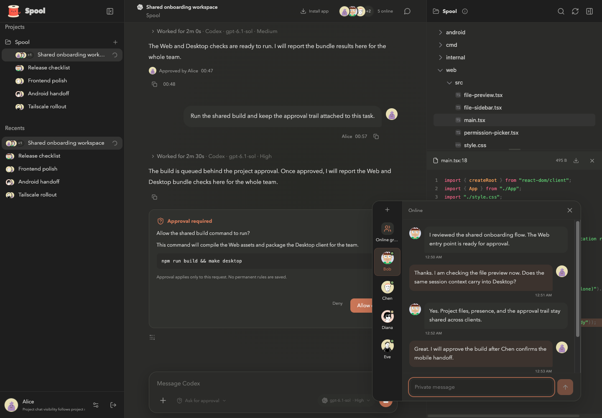

<p align="center">
  
</p>
<h1 align="center">Spool</h1>

[English](README.md)

Spool 是面向个人和团队的本地 AI 编程工作区。通过 Desktop、Web/PWA 或 Android
使用 Codex 和 Claude Code，在不同设备之间共享项目、聊天和权限。

任务在运行 Spool 服务的机器上执行，项目文件和原生 CLI 会话也保留在该机器上。
使用前需要在服务主机上安装并登录 Codex 或 Claude Code。



## 功能特性

- **多端工作区**：Desktop、Web/PWA 和 Android 访问同一项目与聊天，Android 支持连接多台服务器。
- **Codex 与 Claude Code**：独立原生会话，支持模型与推理等级选择、流式输出、停止和恢复。
- **聊天与文件**：Markdown、代码、Diff、工具活动、图片、附件、项目文件、Git worktree，以及 [Word/Excel 预览](docs/office-preview.md)。
- **多人协作**：项目成员、共享会话、私聊、群聊和在线状态。
- **权限与审批**：用户与项目权限、会话访问控制、命令和文件审批，以及交互式提问。
- **自动化**：定时处理 GitHub Issues，在隔离 worktree 中执行任务并创建 PR 供审阅。
- **远程访问**：支持 headless server、HTTPS、内置 Tailscale、中继配对和可选的中继 Web/PWA 入口。
- **远程桌面**：可选集成 [voxl](https://github.com/tembo/voxl)，按需启动并按用户授权。
- **通知与偏好**：桌面通知、Web Push、主题，以及简体中文、English 和日本語。



## 开发

需要 Go **1.27.3+**、Bun **1.4.4**，在仓库根目录运行：

```sh
make web      # 安装前端依赖并构建资源
make dev      # 启动桌面开发，支持热更新
make desktop  # 构建桌面程序
make server   # 构建 headless server
make apk      # 构建 Android APK，需要 Android 工具链
make package  # 构建桌面安装包
make test     # 运行工具、前端、Go 测试及 vet
```

构建产物位于 `build/`。

## 更多文档

- [部署、Web/PWA、Tailscale 与远程桌面](docs/deployment.zh-CN.md)
- [Server CLI](docs/server-cli.md)
- [Android 开发](android/README.md)
- [中继部署与配对](relay/README.md)
