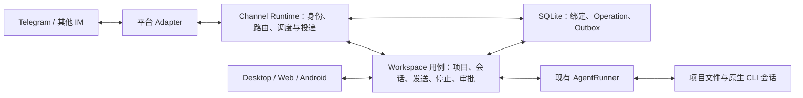

# Channel 接入设计：通过 Bot 与 Spool 交互

状态：设计草案，尚未实现。本文中的模块、数据表、接口和命令均为建议。

## 1. 目标与首版范围

让用户通过 IM Bot 选择 Spool 项目、创建或继续聊天、提交任务、处理必要审批，并接收任务结果。
任务仍在 Spool 所在机器执行，复用该机器上的 Codex / Claude Code 和原生会话。

**首版：一个 Telegram Bot、仅私聊、仅绑定已有 Spool 账号。** 管理员为受信任的成员开启连接并限定项目、
Agent 和权限模式。成员不需要创建自己的 Bot。首版同步本人在 Spool 管理的个人会话中的文本。飞书、Channel-only 人员、
群聊和附件均不是首版前置条件。

**推送按会话设置，不按 turn 的发起端决定。** Bot 创建的会话默认向该私聊推送；从其他入口创建的会话默认关闭，
所有者可在 Web、Desktop 或 Android 的会话设置中开启。开启后，各端继续的是同一个会话，支持现有的跨端 `steer`。

交互规则：

- 推送已进入会话的非 Bot 用户文本（包括 `steer`），以及该会话每轮的最终答复、失败、停止或中断回执。Bot 里已有的用户消息不回显。
- 不发 typing、开始通知、步骤、工具调用、思考、日志、文字增量或周期性进度；同步用户输入不是推送执行过程。
- 需要审批或补充输入时可发交互提示。用户主动查状态、停止任务或管理队列时，回应对应操作，不重复发送同一终态。
- 停止请求胜出后，该轮不再生成成功回执；已提交成功终态的任务不追溯改成停止。

## 2. 架构与现有代码衔接

Channel 是与 Desktop、Web、Android 共用业务能力的入口。平台 Adapter 负责协议、格式和收发，
不直接启动 CLI。Go 后端内置 Channel Runtime，随 Desktop / headless server 运行，共用现有 SQLite、
AgentRunner 和出站网络策略。首版不引入独立 Bot 服务、消息队列或新的运行时依赖。

| 现有能力 | 接入方式与需要补齐的部分 |
| --- | --- |
| [服务与租约](../internal/workspace/runtime.go) | Service 管理 Runtime；运行模式才启动接收器；停止或丢失租约时停止接收、派发和投递 |
| [HTTP 消息与任务启动](../internal/workspace/server.go)、[项目与会话权限](../internal/workspace/management.go) | 提取窄的共享用例，传入实际 Spool 用户和调用来源，保留 HTTP 行为；按实际执行参数校验 Route |
| [内存队列与 steer](../internal/workspace/message_queue.go) | 复用 turn 并发约束和现有引导行为；Channel 的等待消息独立持久化；非 Bot `steer` 在确认进入 turn 后生成同步记录 |
| [审批](../internal/workspace/composer_api.go)、[审批协议](approvals.md)、[停止](../internal/workspace/turn_control.go) | 复用原待处理请求、`NormalizeResponse` 和审计；增加 Bot 交互规则、等待期限及按 turn 实例取消 |
| [任务生命周期](../internal/workspace/store.go)、[原生关联](../internal/workspace/turn_actors.go) | Bot 请求关联 Operation；所有来源共用用户消息同步和终态提交路径，按会话推送设置与 Outbox 同事务落盘 |
| [转录模型](../internal/model/transcript.go)、[Web 展示规则](../web/src/turn-presentation.ts) | 复用结构化片段，不复用仅用于 UI 展示的猜测式回退 |
| [网络配置](../internal/workspace/network.go)、[代理](../internal/netproxy/proxy.go) | 所有平台 HTTP / WebSocket 连接遵循现有代理策略 |

`ClientMessageID` 不是持久执行去重键；`changeHub` 可以唤醒 worker，但不是可重放事件日志。
共享用例不通过内部 HTTP、伪造 Cookie 或模拟管理员调用。

## 3. 平台接入与 Sessio 参考

优先采用 Spool 主动发起的连接，支持无公网入口部署。各平台的应用创建、安装、审核和授权仍由管理员在平台完成；
首版 Spool 提供配置说明、`getMe` 测试连接、Bot 入口二维码和连接诊断，不尝试自动创建平台应用。
配对需要用户能够登录同一个 Spool 实例，但不要求公网入口；可使用已配置的 Desktop、局域网或其他现有访问路径。

| 平台 | 传输 | 阶段与注意事项 |
| --- | --- | --- |
| Telegram | Bot API 长轮询 + Bot API 发送 | 首版。一个 Bot 只允许一个有效接收器，与 webhook 互斥；测试连接不读 `getUpdates`，不自动删除 webhook 或丢弃积压更新 |
| 飞书 / Lark | 企业自建应用事件长连接 + 消息 API | 下一平台。优先官方 Go SDK，区分服务域、租户和应用身份；验证消息及卡片回调的支持、确认时序和 token 刷新。群自定义机器人不是双向应用 Bot |
| Discord | Gateway + 应用命令 / 消息事件 + REST API | 后续。优先应用命令；普通消息单独核对权限及 intents |
| Slack | Socket Mode + Web API | 后续。区分 app token、bot token、workspace 安装和权限；incoming webhook 不能替代双向接入 |

Discord / Slack 的事件或交互在平台要求的期限内确认；长任务用 Bot 凭证投递到已验证的长期目标，
不依赖可能过期的 interaction token 或 response URL。原请求应私密响应却没有长期私聊地址时，
先引导用户建立私聊或在 Spool 执行，不能降级到公开频道。可选 webhook 后续单独设计验签入口，
不放宽 Spool 登录、来源和 CSRF 校验，也不把现有 Relay 当成平台转发服务。

### 3.1 从 Sessio 借鉴什么

- **交互和协议**：参考 `src-tauri/src/im_bridge/platforms/telegram.rs` 的 `getMe`、命令注册、内联菜单、格式化测试；
  参考 `platforms/feishu.rs` 的长连接消息与卡片回调、租户 token 缓存。飞书以所选应用类型和实际 SDK 验证为准。
- **会话恢复与来源标记**：参考 `im_bridge/router.rs` 和 `state.rs` 的持久绑定、按需恢复原生会话、桌面来源标记。
  Spool 保留同一会话 ID；原会话找不到或已归档时明确提示，不把待派发任务静默接到新会话。
- **不沿用其个人桌面默认值**：不从整个聊天的最新上下文推导旧任务的回执地址，不以白名单代替 Spool 人员授权，
  不以会话绑定加内存队列代替可靠受理，不转发 `TurnBuffer` 中的思考和工具过程。Sessio 的微信 iLink 扫码是获取
  Bot 凭证，不是成员加入 Spool 的授权；是否接微信另行评估。

## 4. 身份、授权和会话路由

| 模型 | 职责 |
| --- | --- |
| Connection | 一套 Bot / 应用连接；保存已验证的应用身份、安装范围和配置代次 |
| ExternalIdentity | 在指定 Connection 和安装范围内，将已验证的外部用户绑定到一个 Spool 用户；保留撤销代次 |
| Route | 管理员批准的已有人员、项目、backend、模型、实际运行权限和操作上限；默认拒绝未配置范围 |
| Binding | 一个 Spool 会话与所有者已验证的 Bot 私聊地址的关联；保存推送开关和代次，与私聊的当前会话指针分开 |
| Operation | 一次 Bot 请求的持久受理、操作者、执行状态、原地址，以及与 Spool turn 的关联；其他客户端不需要伪造 Bot 请求 |
| Delivery | Outbox 中的用户消息同步、终态回执或必要交互提示，独立跟踪投递状态 |

### 4.1 绑定已有账号

1. 管理员在 Spool 配置并验证 Bot，设置 Route，公布入口链接或二维码。二维码只打开 `t.me/<bot>`，不携带登录凭证或授权。
2. 用户在 **Bot 私聊**发 `/start` 或 `/spool pair`。服务从平台事件取得 Telegram user ID 和私聊地址，生成短时单次挑战。
   只使用正式接收器，不为“发现用户”另开轮询。链接预览、访问 URL、扫码或 `/start` 本身不授予任何权限。
3. 用户在已登录的 Spool 页面输入配对码，核对平台、Bot 与外部账号信息；再回同一个 Bot 私聊确认 Spool 账号。
   有效绑定只能由对应的已验证外部用户完成，且该 Spool 账号已被管理员列入 Route；不可用用户名、昵称或邮箱代替平台 ID。
   挑战只存摘要，绑定连接代次、安装范围、外部用户与私聊地址，限制尝试次数和速率；激活、消费挑战与审计在同一事务。
4. 绑定不创建用户或授予项目权限。普通用户只能查看和解除自己的绑定。管理员可暂停连接、撤销绑定或调整 Route。
   平台账号被明确移除时撤销对应访问；无法获知的离职仍需管理员禁用，普通网络重连不当作解绑。

私聊地址至少包含 Connection、已验证的安装范围及平台对话 ID；外部身份另存平台用户 ID。
凭证更新后验证是否仍为同一 Bot 和安装主体。主体改变须暂停并重新确认，不能复用旧绑定、挑战、按钮或回执。
同一主体的普通重连不撤销绑定。同一连接与安装范围的外部身份同一时间只能绑定一个 Spool 用户；改绑须先撤销旧绑定并走完整配对。
解绑后重新绑定使用新代次，不能恢复旧请求的投递权限。
撤销或收紧授权时，在授权变更事务中使受影响的待执行、待审批和待投递资格失效；对于仍在运行的 Operation，
继续记录真实终态但不再外发。不能只靠 worker 下次读取权限，否则先撤回再重新授予会让旧请求复活。

### 4.2 会话级推送与跨端续聊

| 会话来源 | 默认状态 | 开启后的行为 |
| --- | --- | --- |
| Bot 私聊创建 | 开启，目标就是创建会话时的已验证私聊 | 在任何 Spool 客户端发起或继续的任务都同步用户消息和结果 |
| Web、Desktop、Android 等非 Bot 入口创建 | 关闭 | 所有者可在任一客户端显式选择已绑定的私聊并开启，之后行为与 Bot 创建的会话一致 |

- 首版只开放本人有权控制、且不会被其他人员写入的个人会话。即使所在项目允许共享，也不能把他人可写的会话同步到个人私聊。
  如果共享设置变更使会话变为多人可写，自动停用推送。是否可控制、是否符合个人会话条件，由后端按实际权限判定。
- 各端共用服务端的推送设置，显示目标和当前状态，所有者可随时关闭。开启后从当下开始同步，不回填已经提交的历史消息；
  若任务正在运行，开启事务同时登记该轮供中断恢复，之后确认进入会话的用户消息和该轮尚未提交的最终结果也会同步。
  界面明确提示：Agent 的新答复可能引用旧会话内容。
- `steer` 继续使用现有跨端行为：Bot、Web、Desktop 或 Android 的输入都可以进入同一轮，不因输入来源不同而拆分答复。
  非 Bot 输入确认进入会话后，向原私聊同步一次并标记来源；Bot 输入在该私聊已有原消息，不重复发。排队、未被 Agent 接收、
  已取消或最终回到队列的输入不提前同步。Bot 的普通文本在忙时默认排队，用户可通过队列菜单把待发送项引导至当前轮。
- 在 Bot 里切换当前会话，只改变后续输入去哪儿，不会停止旧任务，也不会影响任何已开启的会话推送。Delivery 创建时固定会话、
  地址及推送代次；同一个私聊同步多个会话时带上会话标识或平台回复关联，避免混淆。关闭或改绑取消未开始发送的记录，
  不改投旧消息，也不因重新开启而补发停用期间的事件。只关闭推送不等于解绑或停止任务；Bot 仍可提交或查询，但界面明确提示不会自动发结果。
- 同步范围是 Spool 管理的用户文本和终态，不把直接编辑原生历史文件当成消息事件，也不默认传附件、Diff 或项目文件。
  私聊不等于本地存储：已投递内容进入平台消息记录，关闭或解绑不会撤回。

### 4.3 每个动作重新授权

有效权限取「当前账号及绑定有效」「当前项目、会话和动作权限」「Connection / Route 允许」「当前 Binding 代次和目标匹配」的交集。
创建检查 `CanCreateChat`，读取检查 `CanAccessChat`，发送、停止和审批检查 `CanControlChat`；开启推送还要校验会话所有者和个人会话条件。
共享会话访问与本人会话创建是现有的不同权限，不能把某一个标为“只读”就理解成另一个也只读。

Bot 操作在受理、实际派发和审批时复核权限。派发对照本次最终解析的项目目录、backend、模型和权限模式，不只校验消息里的显式参数；
最终授权检查与开始 turn 的事务协调，避免在耗时的目录、模型或 provider 探测期间沿用旧授权。
Bot 启动或 `steer` 任务须符合 Route 给该 backend 配置的实际执行上限，不继承超出上限的会话、项目或复用进程状态。
若无法确认 provider 应用了允许的配置，就不从 Bot 提交输入。不接受外部消息传入额外可写目录；不开放跳过审批、持久权限变更或任意主机操作。
Web、Desktop 和 Android 发起的任务仍按现有权限执行，开启推送不改变本地运行模式；Route 对外发的人员、项目和 backend 限制仍在每段投递前复核。

**项目权限不是执行隔离。** Agent 仍以服务的 OS 用户运行，并使用该环境下的 provider、工具配置和凭据。
项目目录及 provider 审批并非统一的 OS 沙箱；独立 Spool 用户只提供应用级授权和审计。首版只服务受信任的人员。
向不可信人员开放前，另行设计独立执行身份、文件与网络隔离及分离的凭据。

撤权、解绑、停用连接后不得新受理、派发或投递；待执行和待发送记录终止为撤销，不在授权恢复后自动复活。
已执行的普通任务不因 Bot 暂时断线而重跑或自动取消；发生授权撤销时，不能再从 Bot 批准其待处理请求，
本机有权人员仍可查看、停止。已经发出的网络请求和已送达消息无法保证撤回。

## 5. 命令与最小交互

Telegram 注册合法的顶层命令，其他动作由文本参数或内联菜单映射。菜单只列获准资源，
使用绑定操作者、地址、代次和有效期的服务端选择项，不暴露完整会话 ID。

| 业务动作 | 首版形式 | 行为 |
| --- | --- | --- |
| 入口与帮助 | `/start`、`/spool help`、`/spool pair` | 查看可用操作或发起配对；未配对者不能列项目或聊天 |
| 项目与会话 | `/spool projects`、`/spool new`、`/spool chats` | 选项目、Agent 和必要模型选项；显式创建或切换已关联的个人会话 |
| 提交 | 普通文本 | 对已选会话提交任务；忙时普通文本入队，显式引导与其他端使用相同的 `steer` 语义 |
| 查看状态 | `/spool status` | 查询正在运行、等待审批、排队或暂停状态 |
| 停止 | `/spool stop` | 确定目标 turn 并确认；旧按钮不能改作用于下一轮 |
| 管理队列 | `/spool queue` | 查看、取消本人的等待项；provider 支持时可将等待项引导到当前轮；暂停后可显式恢复队列 |

保留 Bot 命令与 Agent 命令的边界。未明确开放的斜杠命令不透传给 provider（含 `/goal` 和原生 skill 命令），
未知 Bot 命令给帮助提示。首版不提供从 Bot 侧管理服务器、人员、凭证和原生会话的命令。

## 6. 审批与补充输入

复用原始 `ApprovalRequest`、`NormalizeResponse`、消费待处理请求和审计。通知只提供用户能据以判断的安全摘要，
不序列化完整审批请求，不把原始命令、工具参数、绝对路径、敏感值或模型提供的跳转 URL 发到平台。
内容无法安全概述时，不给“盲批”按钮，只提供拒绝、停止，或引导到已配置且可达的 Spool 客户端。

- 开启会话推送后，各端发起的任务都可以向 Bot 发必要审批或输入提示；关闭后只在现有 Spool 客户端处理。
  Bot 只支持已知语义的“仅本次允许”和“拒绝”；不能仅按选项名或 `Kind` 放行，不开放会话级授权、持久授权、
  放宽 Route 或复杂策略修改。若任务在 Bot 执行上限之外启动，只发送查看提示，不能从 Bot 批准。
  对 Bot 启动的 turn，禁止扩大 Route 的约束对所有客户端的审批都生效。
- 复杂表单或补充输入在 Spool 内由该任务发起人按当前会话权限处理，不把密钥输入、审批表单答案或设备验证搬到 IM。
  没有可用入口时允许拒绝或停止，不推荐不可达链接，不为卡片回调临时开放公网，不自动批准。
- 回调使用有期限的随机不透明标识，在服务端绑定 Connection、安装和身份代次、Binding、目标地址、chat、turn、
  approval 和允许的 decision。点击时校验真实平台操作者和当前权限；原请求至少保证只被成功处理一次，
  已撤回、已超时、已停止或被其他端处理的按钮显示失效，不能误操作下一轮。
- 对 Bot 发起任务的待处理请求设置服务端等待期限（首版建议默认 10 分钟）。超时或发起人失去授权时，走原协议可用的拒绝或取消路径。
  仅因开启推送而同步审批提示的非 Bot 任务仍用原等待逻辑。提示投递前复核请求仍待处理；按钮过期不等于已经答复。

## 7. 可靠受理、执行与恢复

### 7.1 接收与去重

按 `(connection_id, installation_scope, provider_event_id)` 持久去重；同一提交还按规范化原消息 / interaction ID 去重，
避免不同事件重复创建 Operation。编辑、删除、反应和 Bot 自己的消息不创建任务。拒绝过旧或早于本次连接启用范围的事件。

Telegram `getUpdates` 的较大 `offset` 会确认前面的更新。收到一批后，只有连续前缀中的事件已经持久受理，或已记录明确的忽略／拒绝，
才提交对应游标；有效文本、受理状态和游标可以在同一个 SQLite 事务中写入。重启从持久游标继续。读取失败或持久化失败不能跳过未处理的事件。
后续适配器按实际投递协议核对何时 ACK、何时重投，不能在落盘前向支持重投的协议确认成功。
只承诺已持久受理请求可追踪，不承诺 Bot 离线期间平台保存所有消息。

### 7.2 派发、队列和停止

1. `queued → dispatching`：worker 以当前授权和实际参数复核，使用共享启动入口，与其他入口竞争同一会话的执行权。
   Operation 的认领、chat / turn 关联和开始 turn 的数据库变更在同一事务；提交成功前不调用 provider。
2. `dispatching → running → 终态`：准备启动和实际外部执行不可能形成一个原子事务。
   保证已知请求不重复派发，不承诺任意崩溃下外部副作用恰好一次。遇到可能执行但无法确认的请求，不自动补跑；
   用户检查结果后若决定重新提交，作为新 Operation。
3. 忙时按 session 保留 Channel 等待项的顺序，不承诺跨所有入口全局 FIFO。前一轮失败、停止、中断或服务重启后，
   已受理队列暂停自动续发。`/spool queue` 可取消或显式恢复；恢复仍逐条检查时效、授权及绑定，不能当作批准重跑已派发请求。
4. Bot 等待项显式 `steer` 时关联目标 turn，提交前持久标记，并在确认已被 Agent 接收后记录输入；明确未接收可回队列，
   是否已接收不明时不得自动再次提交。该输入与目标 turn 共用一份最终回执，不为引导项额外生成终态消息。
5. 停止与正常完成竞争同一个状态转换。停止只能作用于捕获的 turn 及其执行实例，不能在检查旧 turn 后再按 chat ID
   取消。停止胜出先标 `stopping` 并禁止晚到的成功结果；只取消该实例，确认退出后写 `stopped`，
   无法确认时写 `interrupted`，不声称已回滚。等待旧实例退出前不派发下一轮。若正常终态已提交，停止只回报实际状态。

服务恢复时扫描持久的非终态 Operation 和已纳入会话同步的 turn 记录（包括非 Bot 轮次），不把 `sessions.status=running`
当成唯一信号：当前 `OpenAdministration` 也会调用 `SetInterrupted`。对无法确认结果的 `dispatching`、`running` 或 `stopping`
写入 `interrupted`，仍可推送时生成唯一回执；尚未派发的 `queued` 保留并标为暂停。恢复与工作领取受当前数据库租约约束；
恢复和终态写入必须幂等。

## 8. 同步用户消息、最终答复与投递

### 8.1 用户消息同步

所有来源共用同一条投递规则：用户文本实际成为会话输入时，读取会话的推送设置。非 Bot 用户文本生成一个 Outbox 事件；
Bot 输入的原消息只保存关联，不回显。正常输入在开始 turn 时记录；`steer` 在确认进入 turn 时持久记录，和待发送消息同事务提交。
共享用例给每条实际进入会话的输入分配稳定 ID，按输入 ID 与推送目标去重，不用文本内容去重，也不从原生历史重新推断作者或来源。
同一轮的用户输入先于终态回执投递；暂时失败按同一会话的顺序重试，已到期、永久失败或状态未知时不无限阻塞后续消息。
同一私聊的多个会话允许交错。投递失败不回滚已经提交的用户输入。

### 8.2 生成终态回执

完成路径在写入终态**之前**从该 turn 取得已定稿的结构化片段，此时 live 数据尚未清理。
只要会话当前开启推送且该轮仍有投递资格，各个来源的轮次都生成回执，不要求存在 Bot Operation。
成功时只取该轮正式的 `role=assistant`、`kind=text`、`phase=final_answer`，或 provider 明确标为最终答复的独立正文。
按消息 ID 和片段顺序合并，保留代码与换行。同一 Spool turn 因 `steer` 涵盖多个 provider 片段时，只发送该轮结束时对应最后一次已接收输入的最终答复，
不把引导前已经结束的答复当作引导后的结果。没有可信标记时只发“任务已结束，但未取得可发送的最终答复，请在 Spool 查看”。
不把“最后一次工具调用之后的文字”当作可靠的外发依据，不转发累计 `Reply`、`AgentResult.Text` 或 `Activities`，
也不额外发起模型调用摘要。输出只在终态发送不代表模型不会在最终答复中写出敏感内容，不能把简单清理当作内容隔离。

| 情况 | 回执 |
| --- | --- |
| `completed` | 发送最终答复，或在无法确认正文时引导查看 |
| `failed` | 发送公开错误类别、简短建议和查看入口，不用部分过程输出填充 |
| `stopped` | 向会话绑定的私聊发送一次终态回执；同一私聊发出的 stop 命令不再另发一条“已停止” |
| `interrupted` | 说明执行中断或无法确认结果；引导检查，不承诺回滚或自动重跑 |
| 等待审批 / 必要输入 | 单独发送有效交互提示，不与最终回执共用去重键 |
| 受理或校验失败 | 对已验证的请求者回应通用或可操作的简短原因，不创建执行任务 |

工具失败但 Agent 恢复并完成，只发最终答复。完整 stderr、堆栈、绝对路径、凭证和敏感工具输入留在本机诊断。
查看链接只用已配置的可达入口，不携带登录凭证；无可达入口时说明使用有权的本机客户端，不发送服务端 `localhost`。

### 8.3 Outbox 及保留策略

turn 的真实终态、相关 Operation（如有）及应推送的唯一 Outbox 记录同事务提交。会话关闭推送或失去外发资格时仍记录真实终态，
不保留外发正文。完成、停止和中断恢复走同一约束，不在成功回调里重读原生历史，不依赖内存 completed 缓存或 Web Push 队列。
每个 turn 对其会话推送目标只允许一份最终回执，不能分别按 `completed`、`stopped` 插入两份；分段用回执 ID 与分段序号追踪。
用户消息按输入 ID、审批提示按实际 approval ID 分别去重。发送前复核授权、推送代次和原地址，每段按平台限制处理格式、代码块和提及。

投递 worker 不在 Agent 回调或持锁区做网络 I/O。明确可重试的限流、未发出的网络错误按 `Retry-After` 或退避处理；
永久失败在 Spool 展示。若请求可能已被平台接收而响应丢失，优先用平台幂等能力或查询，无法确认标为 `delivery_unknown`，
不盲目重发。分段按序投递，不重发已确认分段；某段状态未知时暂停该回执的后续段。投递失败不修改执行终态，也不能触发 Agent 重跑。

首版建议成功正文保留 24 小时，未完成投递最多保留 7 天；等待请求有明确有效期，到期后可查询并在授权仍有效时提示。
按连接、用户、会话限制输入速率、队列容量、正文大小和并发；为已受理任务预留终态记录空间，Bot 超限时在受理前拒绝。
Outbox 容量不足时不阻断其他客户端的正常聊天，明确显示未同步或需要处理的投递状态，不静默丢弃旧任务记录。
派发后移除不再需要的输入正文，去重键和执行关联覆盖平台重投窗口及正文保留期。
正文、诊断与去重记录分开清理；待发正文不是第二份永久会话历史。

## 9. 持久化与管理

建议由 `internal/channels` 定义规范化地址、消息、Adapter 与所需的窄接口；`internal/workspace` 实现共享用例和事务，
注入 Service。平台适配器不依赖 workspace。先实现 Telegram 适配器和测试用的本地假 Adapter，不预先实现跨平台通用框架。

| 首版持久状态 | 关键内容 |
| --- | --- |
| Connection、Route | 已验证主体、配置与授权代次、项目 / backend / 模式上限、`secret_ref` |
| ExternalIdentity、Pairing | 验证上下文、Spool 用户、一次性挑战摘要、有效期和撤销代次 |
| Binding、当前指针 | 会话所有者、已验证地址、推送开关及代次、当前选择及来源标记 |
| Inbox / Operation、Checkpoint | Bot 去重键、输入、排队与暂停状态、原请求地址、chat / turn 关联、平台游标 |
| 同步输入与 turn 关联 | 稳定输入 ID、来源及作者、turn 状态；支持非 Bot 轮次中断恢复和已接收 `steer` 去重 |
| Outbox | 用户消息、终态或审批提示的唯一键和地址快照、有期限正文、分段、重试状态、外部消息 ID、到期时间 |

凭证放在独立的私有凭证文件，复用现有 Relay 配置与凭证分离做法。Unix 使用私有目录及 `0600` 文件，
Windows 限制对应用户的访问；文件权限不等同加密。日志、状态、配置快照和 CLI 不回显凭证；过滤可能带 token 的请求 URL。
连接诊断只显示连接状态、最近接收、待处理数、失败类别和投递状态，不记录完整输入或原始平台 payload。
人员绑定、连接配置、撤销和授权变更做结构化审计；任务审批和停止继续记录实际操作者。

Desktop 本机设置负责添加、测试、启停连接和 Route，提供入口二维码及诊断。headless 沿用当前停服后本机 CLI 管理和租约规则；
管理员可在初次配置时一次性授权已有成员，成员随后自行配对，不必为每次配对停服。首版 headless 不承诺在线修改 Route 或紧急停用连接；
需要管理员撤销且无可用授权管理入口时，应先停服，然后更改配置。普通用户仍可在线解除自己的绑定。后续可以增加受本机身份保护的运行时管理入口，
不增加公开管理员 HTTP API。

单一连接配置或网络失败不阻塞其他入口。重连或热配置时先取消并等待旧接收器退出，再启动新的接收器，
不借重启共享 App 来重连 Bot。关闭服务或丢失租约时停止接收、新派发及未开始的投递；正常关闭继续按现有任务取消规则记录终态，
等待所属 worker 退出后再关闭 Store。失去租约的 worker 不再认领任务、写入回执或发送新请求，由新持有者恢复；
已经在途的网络发送按结果可确认性处理。`OpenAdministration` 不启动平台接收或投递。

## 10. 实施阶段与验收

| 阶段 | 交付范围 |
| --- | --- |
| P0：共享用例和假 Adapter | 在真实 Workspace turn 生命周期上验证持久受理、会话级同步、跨端 `steer`、审批、停止和唯一终态回执；保留现有客户端行为 |
| P1：Telegram 私聊 | 管理员配置一个 Bot；受信任的已有账号自助配对；创建或继续个人会话；Web、Desktop、Android 共用推送开关；文本、状态、队列、停止、简单审批和结果同步 |
| P2：飞书 / Lark 私聊 | 验证自建应用长连接和卡片回调；适配租户／应用作用域、token 刷新，保持相同的配对、执行和回执语义 |
| 后续 | 按需增加 Channel-only 人员和邀请制、群聊／线程、Discord、Slack、附件及 webhook；微信 iLink 另行评估 |

首版验收以可观察行为为准：

1. 管理员设置 Bot 后，已有账号能自行配对；扫码预览、过期／重复挑战、跨私聊点击不激活绑定。普通消息不代替登录；未经选择不执行。
2. 两个用户、两个项目和同一私聊两个会话并行时，不串输入、审批、停止或回执；切换当前会话不影响原推送目标，改绑不改投待发送内容。
3. Bot 创建的会话默认会同步非 Bot 用户消息及所有轮次结果。普通会话默认关闭，所有者可从三个客户端任一端开启或关闭；不回填历史，其他端同步设置，不允许为多人可写会话开启。
4. Bot 发起后在 Web / Desktop / Android `steer`，或非 Bot 发起后从 Bot `steer`，都进入同一轮；已接收的非 Bot 输入恰好生成一份推送记录，Bot 输入不回显，退回队列的输入不提前推送。
5. 任务期间不发 typing、草稿、工具或思考；工具失败后恢复只发最终答复，无最终标记发查看提示。Bot 操作不能突破 Route；仅开启推送不改变本地执行权限。
6. 旧审批、过期审批、跨人点击和并发点击不影响新 turn；复杂交互无可用入口时能拒绝或停止，不泄露原始审批参数。
7. stop 与完成并发只保留一个真实终态；旧 stop 不杀新进程；失败、停止及重启后的 Channel 队列暂停，只有显式恢复才继续。
8. 在受理、启动事务、provider 提交、终态和投递各边界模拟中断；先跑管理 CLI 再启动也能恢复 Bot Operation 和待同步的非 Bot 轮次；不盲目补跑。
9. 关闭推送、改绑和撤权阻止不再获准的投递；已确认的分段不重发，响应丢失得到明确的投递未知状态。
10. 本机代理变更、凭证轮换、连接停用及服务关闭没有残留接收器或重复消费者；没有公网 Web 入口也可运行 Bot。

实现时从 `internal/channels` 与受影响的 `internal/workspace` 用例测试开始；Go 改动运行相应 vet，涉及队列、取消和关闭的加 race 检查。
设置页面涉及 TypeScript 时运行类型检查和选定 Web 测试。用假平台与现有 Agent fixture 验证业务后，再按实际启用的平台进行隔离联调。

## 11. 后续能力的边界

- **Channel-only 人员与邀请制**：沿用 People 和 Projects，不建第二套成员目录。入口二维码只打开 Bot 或加入入口；定向邀请携带短期、
  单次、可撤销的随机标识，只在验证外部身份和完成确认后原子消费。未限定实际外部身份的邀请不得先到先得绑定已有账号。
  需实现显式禁用密码登录、账号升级或已授权的审批接手路径，并解决 headless 在线申请审核，再开放自助加入。
- **群聊 / 线程与多人会话**：必须明确批准发布目标、范围及哪些成员的输入可同步；一个线程独立绑定，不能以群 ID 代替线程键，不能导入个人历史。
  平台群成员可见性不等同于 Spool 权限；每位操作人仍须单独授权。本人私聊的会话级默认规则不能直接继承到群聊或多人会话。
- **附件与可选 webhook**：附件按明确选择、授权和文件访问规则交付，不直接解析 Agent 输出中的文件路径并上传。
  webhook 使用独立验签、重放保护和最小暴露，不借用普通登录入口实现回调。

## 12. 官方资料

- [Telegram Bot API](https://core.telegram.org/bots/api)：`getUpdates`、webhook、命令、按钮和消息格式限制。
- [飞书开放平台](https://open.feishu.cn/document/home/index)与[官方 Go SDK](https://github.com/larksuite/oapi-sdk-go)：自建应用 Bot、身份范围、长连接、事件和卡片回调。
- [Discord Developer Documentation](https://docs.discord.com/developers/intro)：Gateway、interactions、intents 和限流。
- [Slack Socket Mode](https://docs.slack.dev/apis/events-api/using-socket-mode/)：应用 token、事件确认和交互；具体操作核对 Web API scopes。

平台权限、回调支持、确认期限与限流以实际应用类型和接入时的官方文档为准。
