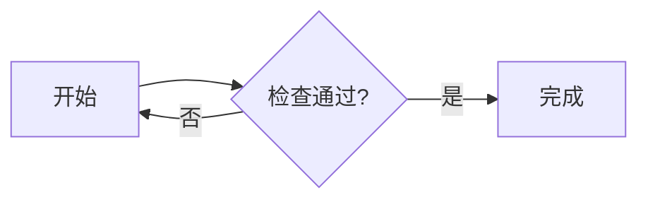

# Markdown and Mermaid

Web, Desktop and Android render fenced `mermaid` blocks as diagrams in messages,
expanded Markdown details and Markdown file previews. For example:

````markdown

````

Diagram colors follow the selected light/dark theme. The code header's copy
button copies the original Mermaid source. While a streamed diagram is incomplete,
or when its syntax cannot be rendered, the block displays selectable source.
Subsequent source updates retry rendering. Inline Markdown summaries remain text.

Two icons immediately before Copy switch between diagram/source and open a large
diagram viewer. The viewer supports zoom in/out, fit to window, drag to pan,
pinch to zoom and Ctrl/Command + wheel zoom. Close it with its close icon, Escape
or Android Back. The viewer shows a loading indicator while rendering and only
falls back to source after a render error. Source changes also update an open
viewer. Source uses Mermaid syntax highlighting in both themes while retaining
selectable/copyable text.

The Mermaid library ships with the application; rendering requires no external
diagram service or CDN. All clients use the same isolated document and strict
Mermaid configuration. Web/Desktop use a sandboxed iframe. Android keeps its
native Markdown layout and uses an offline WebView only for each diagram. The
document blocks remote resources; diagram links and callbacks are not activated.
The Android bridge accepts only the render revision, success state and height.
Detached Android diagrams destroy their WebView and reject stale results.

## Development

Install Web dependencies with Bun before building Android. Gradle's
`prepareMermaidAssets` generates the Android document and license under
`build/android/mermaid/assets/` using the pinned Web dependency and shared frame.
Generated library bundles are not committed.

Relevant checks from the repository root:

```sh
make test-web WEB_TESTS=./test/markdown-message.test.mjs
sh tools/run.sh mermaid-types bun run --bun --cwd web check
sh android/gradlew :app:testDebugUnitTest --tests '*NativeMermaidTest' --tests '*NativeCodeBlockTest'
```

The browser check runs Chromium and WebKit against a production build with the
server's CSP, the Vite development client and the generated Android document.
It checks common diagram types, copy, stream updates, invalid-source recovery,
themes, narrow/wide layouts, inert diagram links and isolation:

```sh
sh tools/run.sh mermaid-assets bun android/tools/build-mermaid.mjs
sh tools/run.sh mermaid-browser bun web/test/mermaid-smoke.mjs
# Exercise the desktop server gateway with sandboxed script requests as well.
sh tools/run.sh mermaid-desktop env SPOOL_MERMAID_BROWSER=1 go test ./cmd/desktop -run TestDesktopMermaidBrowser -v
```

It requires Playwright with Chrome and WebKit available. Set `SPOOL_NODE_MODULES`
to an existing Playwright installation if it is outside `web/node_modules`.
Screenshots and the browser report are retained in `build/artifacts/mermaid/`.
