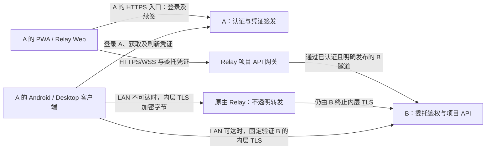

# 基于 Relay 的服务器互访：可行性审查与实现设计

设计修订日期：2026-11-11。此前代码审查基线：`f290ac6`。
状态：设计草案，尚未实现服务器联邦；本文中的接口、凭证和数据表均为建议。

## 1. 方案边界与结论

方案可行。Android、Desktop 使用原生 Relay 隧道请求 B，保留经过身份验证的 LAN 优先连接。
PWA / Relay Web 等浏览器客户端使用 Relay 的 HTTPS/WSS 项目 API 网关。
A、B 继续通过主动连接接入 Relay；两类传输共用项目 API、服务器互信及用户委托授权，不要求原生端经过 HTTP 网关。
本版跨服务器委托访问仅支持 Relay 体系，不在 B 的 Public URL 或 tsnet 入口开放。
原生 Dialer 的 LAN 优先属于固定验证同一 Relay 身份的连接优化，不等于支持任意直连 URL 或 tsnet 联邦入口。
服务器身份、业务授权和网络可达性是三件独立的事，添加地址本身不会建立服务器互信。

本次讨论确定的设计如下：

- A、B 各自保留账号体系，双方只批准服务器，不管理对方人员。
- B 选择授予 A 的项目和操作上限；A 决定自己的哪些用户能使用这些项目。
- A 认证用户，并签发面向 B 的短期凭证；原生客户端经 B 的原生通道、浏览器客户端经 B 的 API 网关访问 B。
- A 用户登录 A 的客户端，由 A 客户端请求 B 服务器的项目 API，在 A 客户端中查看和操作 B 的项目。
- A 的用户身份和凭证不能用于登录 B 的客户端，也不能换取 B 的账号会话或管理权限。
- 业务请求、文件和事件在用户设备与 B 之间传输，不经 A 服务器；网络可为经过验证的 LAN 或 Relay，A 负责认证和续签。
- 两类传输的最终委托凭证与项目权限均由 B 验证。原生 Relay 只转发加密字节，普通 HTTPS API 网关可见业务明文。
- A 修改用户权限后通知自己的客户端；客户端换取新凭证，切换连接并删除旧凭证。
- 第一版不要求 A 向 B 推送用户撤权，不在 B 保存 A 的用户权限版本或用户黑名单。
- B 始终执行自己的当前授权，并检查凭证签名、目标、设备绑定和有效期。
- A 撤权对正常客户端随换证生效；保留下来的旧凭证最迟到期失效。此窗口必须明确接受。
- 双向共享分别授权；第一版官方协议只允许使用本服身份访问对方，不提供继续转授给第三台服务器的能力。

这里的“B 不管理 A 的用户”不等于 B 完全不知道操作者是谁。
B 仍需知道请求来自哪个服务器、哪个来源用户，以区分聊天所有权并记录审计。
B 信任 A 对这些身份的声明，不能独立证明用户是否真的在 A 输入了密码。
A 的管理员持有签发权限，能代表 A 声明用户；B 用授予 A 的项目和操作上限约束这种信任。
B 也不能独立确认 A 声明的用户来自哪个实际组织，或阻止 A 自行转发已获准的数据。
因此不转授是官方协议和受信管理员的约定，不能被描述为对恶意 A 的密码学保证。

## 2. 现有连接方式与主要实现缺口

### 2.1 网络连接方式

| 方式 | 提供的能力 | 对互信方案的影响 |
| --- | --- | --- |
| Tailscale / tsnet | 在已配置的网络内提供可达地址和传输保护 | 本版不开放跨服务器委托访问；保留原有本服连接与登录语义 |
| B 的 Public URL / HTTPS 反向代理 | 将 B 的普通服务暴露为 HTTPS 入口 | 本版不开放跨服务器委托访问；不能据此兑换 A 凭证或登录 B |
| Relay HTTPS/WSS API 网关 | 浏览器经标准 HTTPS/WSS 调用目标的项目 API | PWA / Relay Web 的联邦入口；新增 API 发布、委托认证及浏览器跨源支持 |
| 原生 Relay | 原生客户端经中继连接目标，内层 TLS 验证目标身份；优先尝试经过验证的 LAN 地址 | Android / Desktop 的联邦传输；复用现有 Dialer，新增受委托客户端准入 |

本次范围是 Relay 联邦访问，Public URL、tsnet 及现有 Relay 均未自动具备这套委托能力。
统一的是业务 API 与授权规则，传输按客户端能力选择。原生端不为兼容 PWA 而强制经过 HTTPS 网关。
浏览器不能直接复用 Go Dialer，因此在 B 只通过 Relay 对外连接的部署中，需要浏览器兼容的 API 网关。
是否支持某种传输由受信入口显式决定，不能只因请求携带有效签名就对所有入口开放联邦 API。
以后若扩展 Public URL 或 tsnet 需单独设计准入并验证，不在本版隐式支持。
Relay 的 HTTPS 网关地址属于 Relay 入口，不代表 B 开启了 Public URL 连接模式。
URL 只是入口，服务器公钥及其派生 Server ID 才是服务器互信依据。

### 2.2 审查发现

以下是新功能的实现门槛，不代表现有单服务器功能已经存在相应漏洞。

| 优先级 | 发现与影响 | 实现要求 | 现有依据 |
| --- | --- | --- | --- |
| P1 | 配对只解决设备准入，不自动授权 A 的用户设备直连 B | 新增服务器配对用途及受委托客户端入口，验证 A 签名和客户端持钥证明 | [devices.go](../relay/devices.go)、[device.go](../relay/device.go) |
| P1 | 换发凭证不会使旧签名失效，长连接还可能绕过仅握手时的过期检查 | 明确旧凭证剩余有效期；请求、WS、SSE、文件流均受凭证期限约束 | [realtime.go](../internal/workspace/realtime.go)、[server.go](../internal/workspace/server.go) |
| P1 | 现有用户、聊天所有者和操作记录引用本机用户表 | 增加外部 actor 表达和持久化关联；不能把同名账号合并或公用一个远程账号 | [store.go](../internal/workspace/store.go)、[turn_actors.go](../internal/workspace/turn_actors.go) |
| P1 | 当前个人聊天、共享聊天和任务协作者具有不同的权限路径 | 统一取联邦权限上限与资源规则的交集，不能仅设置现有成员只读字段 | [management.go](../internal/workspace/management.go)、[preferences.go](../internal/workspace/preferences.go) |
| P1 | 换证或断线后的自动重试可能重复执行写操作 | 持久化请求去重、结果查询；传输恢复不自动重放 mutation | [client.go](../relay/client.go)、[server.go](../internal/workspace/server.go) |
| P1 | 允许运行 Agent、选择权限模式或回应提权审批，可能超出 API 的项目边界 | B 独立约束后端、权限模式、文件根和审批权限；项目控制不默认授权主机级提权 | [process.go](../internal/agent/process.go)、[server.go](../internal/workspace/server.go) |
| P1 | 项目 API 返回的文件、附件或预览若被当成可执行页面透传，可能取得本机页面源的能力 | 本机生成安全响应头、隔离预览、过滤重定向和 Cookie；不加载 B 的应用页面 | [project_files.go](../internal/workspace/project_files.go)、[file-preview.tsx](../web/src/file-preview.tsx) |
| P1 | 项目目录变化或授权撤销后重建，可能让旧授权关联到新的资源范围 | 导出绑定独立标识和资源根；信任重建更新代次，旧凭证和本机分配不能自动继承 | [management.go](../internal/workspace/management.go) 的 `SaveProject` |
| P2 | 前端使用单服务 API、全局认证状态，WebView 不能直接调用 Go Relay Dialer | 新增设备本地传输适配层及按服务器隔离的请求、缓存和订阅 | [api.ts](../web/src/api.ts)、[main.tsx](../web/src/main.tsx)、[chat.go](../cmd/desktop/chat.go) |
| P2 | 短凭证配合长流和大文件，若只靠重建连接会反复中断 | 固定同主体的流续签协议；文件使用可恢复分块、Range 和最终确认 | 本文第 8 节 |
| P2 | 连接限额不能约束模型账单、后台任务和持久化数据增长 | 按来源服务器限制执行、用量、上传和磁盘预算，不只按用户限流 | 本文第 8 节 |
| P2 | 去重记录清理或恢复旧备份后，旧请求可能被当成新请求执行 | 定义操作受理窗口、持久化摘要及恢复代次；不能将去重记录当临时缓存 | 本文第 8 节 |

项目导出约束的是应用接口。B 上运行的 Agent 仍使用 B 的 CLI、系统账号和原生权限策略。
这不能被描述为操作系统级项目隔离；严格隔离不同信任方需要另行设计进程或容器边界。

## 3. 不经 A 转发的两类数据流

“用户设备 C”可以恰好是运行 A 的 Desktop，也可以是另一个获准登录 A 的设备。
这里的 A 客户端是用户在 C 上登录 A、使用 A 身份的客户端实例，不是 B 的客户端登录会话。
原生设备的本地传输层运行在 C 上，与 B 建立内层 TLS；PWA 使用浏览器到 Relay API 网关的 HTTPS/WSS。
“直接请求 B”指业务目标是 B、不经 A 服务器转发，不表示所有网络条件下均可绕过 Relay。



A 不在业务数据路径中。A 离线后，已签发凭证可以使用到期；到期无法续签，访问暂停。
这不等于 A 可以长期离线，除非接受更长的凭证有效期及相应的撤权窗口。
双方可以使用不同的 Relay 部署：访问 B 就使用 B 的受信连接信息。
图中省略 A 登录入口内部的传输及两端可能使用不同 Relay 的情形；访问 B 不要求先经过 A 所在 Relay。
A 的登录及续签复用现有入口，原生客户端可继续使用现有 A 连接，不强制将其改成网关登录。

网关路径中，客户端 HTTPS/WSS 在 Relay 终止，Relay 经固定验证 B 身份的连接转发项目 API；Relay 属于数据传输信任边界。
原生 Relay 的内层 TLS 则在 C 与 B 之间终止。这两种模式不能混用“Relay 无法读取明文”的承诺。
普通浏览器不能直接使用 Go 的自定义 Relay Dialer、固定公钥校验和客户端证书流程；安装为 PWA 不会增加这些权限。
原生端无需 API 网关，但也不能仅凭 B 的名称或公网地址绕过当前准入；具体客户端接入见第 8.5、8.6 节。
这里讨论的是 A 客户端调用 B 项目 API 的传输能力，浏览器客户端也不使用 A 身份登录 B 客户端。

## 4. 服务器身份、配对和委托准入

### 4.1 服务器互信

复用 [identity.go](../relay/identity.go) 中的 Ed25519 身份和 `ServerID(publicKey)`。
名称、URL、IP 和 Relay 路由信息可以变化，固定的公钥才决定信任对象。
公钥变化视为新身份，重新批准；不能通过同名服务器自动继承授权。
`DeviceFingerprint` 与 Server ID 的字符串编码不同，实现时不能直接比较二者。

建议增加独立的服务器配对用途，例如 `spool-peer:`，普通 `spool-pair:` 保留设备语义：

1. B 在本机生成短期邀请，包含协议版本、B 公钥和必要的连接信息。
2. A 导入并确认指纹，通过配对通道证明持有 A 的私钥。
3. B 的本机管理员批准“信任 A 认证自己的用户”，保存 A 的公钥和状态。
4. B 选择授予 A 的项目及操作上限，A 保存导入项目的元数据。
5. A 在本机为自己的用户分配这些项目；无需向 B 发布用户目录。

反向共享单独批准。邀请需保持现有的一次性、到期、绑定首个请求公钥和拒绝后不可恢复的语义。
管理入口沿用本机受保护的设置桥接或本机命令，联邦业务接口不能修改服务器互信关系。

B 为每次新建的入站信任生成 `trust_epoch`，撤销后重新批准不沿用旧代次。
每次新建项目导出生成不可复用的 `export_id`；A 的人员分配绑定此导出，不仅绑定 Project ID。
两者由 B 管理，属于服务器及资源授权，不是 A 的逐用户权限版本，也不要求 A 向 B 推送用户撤权。
短期凭证带上这两个标识，B 除当前权限交集外还检查是否属于同一次授权。

项目根目录或导出对象的语义改变时，先暂停原导出；由 B 确认新范围后创建新导出，A 重新分配。
当前 `SaveProject` 允许尚无聊天的项目在保持 ID 的同时更换路径，因此不能只用 Project ID 维持共享。
普通名称修改不重建导出；普通权限上限调整仍由 B 的当前策略即时执行。
撤销或删除的导出标识不得因重启、重配或同名项目创建而复活。

### 4.2 受委托客户端准入

现有原生设备准入要求本机批准每个设备。联邦访问改为服务器互信后，B 根据 A 签名的凭证接纳用户设备，
不再逐台要求手机与 B 扫码配对。前提仍是设备在 A 完成必要的认证和准入，而不是自报来自 A 就可访问。
两类委托传输共同满足：

- C 生成自己的客户端密钥，向 A 证明持有该密钥；A 将公钥指纹写入凭证。
- A 向 C 提供已批准的 B 身份及目标连接信息，不允许客户端指定任意地址冒充已授权目标。
- 原生 C 固定验证 B 的公钥，使用设备 TLS 客户端证书证明持钥，B 将证书公钥与凭证的 `cnf` 绑定核对。
- 浏览器 C 使用 B 的受信网关地址和标准 HTTPS/WSS，提交凭证与请求持钥证明；网关固定验证其连接的 B。
- B 使用已批准的 A 公钥验证凭证；来源服务器不能由普通 header 或 SNI 自报。
- 正常设备、服务器控制连接、委托客户端和 Relay Web 保持用途隔离，不能相互绕过准入。
- B 的委托入口及浏览器网关均限制认证次数、请求体积和并发；网关不能替代 B 的最终鉴权。

服务器控制连接使用 A 自己的密钥；用户设备使用自己的密钥，不能获得 A 的服务器私钥。
原生准入新增独立的委托 TLS 模式：可在受限认证入口接受尚未列入 B 设备名单的证书，再验证 A 的委托凭证。
验证完成后也只允许联邦项目 API，不能回退到普通设备或普通账号接口。
TLS 恢复、连接池和换证仍核对凭证主体与设备绑定，握手成功不自动形成长期业务授权。
Public URL 与 tsnet 的普通 handler 不挂载委托入口，客户端也不能以普通 URL 或 tsnet 地址替换已批准的 Relay 目标。
即使某个入口网络上可达，仍不能仅凭 A 的签名令牌构造联邦上下文。

浏览器网关不持有 C 的设备私钥。持钥证明中的外部 API URL 与 B 内部路由的映射必须来自已批准配置，
不能接受任意 Forwarded/Host 头决定证明的校验目标；浏览器跨源不等于授信请求来源。
两类传输均不能仅相信网关注入的用户头、客户端自报的公钥或放宽现有来源校验。

`relay` 是独立 Go module，应提供用途和可注入的准入能力；用户、项目和 SQLite 授权留在 workspace 层。
VPS 的注册与原生转发可复用；B 需新增原生委托准入，浏览器路径另增 API 网关发布和受限转发，均需兼容性验证。
Relay 隧道准入凭据不是用户权限，不能代替短期凭证。

### 4.3 A 客户端访问 B API，不登录 B 客户端

A 用户始终登录 A 的客户端，以 A 为身份来源；A 客户端持有 A 签发的委托凭证，直接请求 B 服务器。
B 只为这类请求构造受限的外部访问上下文，不创建 B 的客户端登录会话。
B 的 Desktop、Web 或其他客户端登录流程均不接受 A 的用户身份或委托凭证作为本机账号认证。

委托客户端连接只挂载明确列出的联邦项目 API 及认证、事件、文件传输端点。
其余路径默认拒绝，不回退到 B 的普通 Web handler 或 SPA 首页；页面、登录、静态应用资源和管理端点均不通过这条连接提供。
不仅按 URL 前缀判断，还需同时验证 method、规范化路径、资源类型和对应操作权限。

A 用户凭证仅在这些联邦 API 中有效，不可兑换成 B 的登录 Cookie、普通账号会话、Web 登录码或管理凭据。
B 的普通 Web 和账号登录接口不接受 A 的凭证；服务器配对成功也不创建 B 的可登录账号。
鉴权失败返回结构化 API 错误，由自己的客户端处理续签或显示原因，不重定向到 B 的登录页。

客户端界面、页面导航和静态应用资源均由自己的客户端提供，项目数据、文件和任务执行结果来自 B。
项目中的 HTML 文件属于待隔离预览的业务内容，不是 B 的应用页面，也不因此获得登录能力。
如果 B 另有公开 Web 入口，其登录页是否可通过网络到达由该入口的部署决定；联邦授权不赋予任何登录权限。
验收的边界是 A 的身份和凭证只能调用已授权的项目 API，不能被其他入口当成 B 的本机账号。

## 5. 短期凭证与权限计算

### 5.1 凭证内容与验证

采用成熟的签名令牌实现，例如固定 EdDSA 算法的 JWS/JWT，避免自制编码和签名规范。
建议包括以下字段；最终字段名在协议实现前固定：

| 字段 | 含义 |
| --- | --- |
| 协议版本、类型 | 专用于 Spool 联邦访问，拒绝其他用途的签名对象 |
| `iss` | 签发服务器 A 的稳定 Server ID |
| `sub` | A 的稳定用户 ID，不使用姓名或邮箱合并身份 |
| `aud` | 目标服务器 B 的 Server ID，不能用于 C 或反向访问 A |
| `trust_epoch` | B 本次批准 A 的信任代次，旧信任的凭证不能跨重新批准继续使用 |
| `iat`、`exp` | 签发及到期时间，受 B 的最大有效期约束 |
| `grants` | A 当前允许该用户访问的 B 项目、对应 `export_id` 及操作范围 |
| `cnf` | 实际访问设备的公钥绑定 |
| `jti` | 凭证标识，便于诊断；第一版不因此建立逐凭证撤销表 |

A 从自己的已认证会话解析用户，重新读取其权限，再签发凭证。
客户端只能请求目标和所需范围，不能自行指定可信的用户身份或扩大 grants。
签发与权限变更需要明确并发顺序，不能让异步签发任务在权限变更后继续基于旧快照签发新期限。
一种实现方式是在签发提交前复核本机策略版本；该版本只在 A 内使用，无需同步给 B。

B 每次使用凭证时检查签名、公钥所属的 peer、用途、目标、时间、设备绑定、项目和操作。
固定允许的算法和字段约束，拒绝从令牌内任意 URL 获取验证密钥。
B 必须拒绝超出最大寿命的凭证，不能只相信 A 提供的一个很远的 `exp`。
凭证不得出现在 URL、日志或持久化的前端缓存中；续签只向 A 发起，B 不签发更长的替代会话。

### 5.2 有效权限

```text
B 对 A 的当前信任
AND B 当前授予 A 的项目与操作上限
AND A 签发凭证内的用户项目范围
AND B 的资源所有权、共享、文件与任务规则
```

B 的资源规则需要支持外部 actor，不能假定已有本机成员行就会自动表达这套授权。
A 可以收紧权限，不能突破 B 的授权上限。B 不保存 A 的逐用户 ACL，也不审核 A 的人员变动。
凭证中即使仍列着某个项目，B 删除相应服务器级授权后也必须拒绝访问。

项目可见不等于全部聊天可见。个人聊天、共享聊天、任务协作者和只读限制必须分别检查。
联邦只读禁止创建、发送、停止、审批及其他写动作，不能被现有个人聊天或协作者路径绕过。
项目授权不隐含账号管理、CLI 配置、整机桌面或转授权权限。
文件访问限制在项目及获准的工作树内，不能直接继承本机允许读取项目外文件的设置。

### 5.3 Agent 执行与审批边界

B 的项目导出另设可执行后端、权限模式上限、允许的文件根及审批能力。
这些由 B 执行，不能只在客户端隐藏模式选择，也不能仅验证某个模式在 B 的 CLI 上可用。
工作目录、原生会话路径和可写目录由 B 从已授权资源推导，不能接受客户端任意指定。

普通项目控制权限不默认授予越出项目的主机级权限。
涉及扩大沙箱、增加项目外文件访问、访问凭据或运行具有主机权限的工具的审批，默认留给 B 本机管理者。
普通任务交互和主机级提权应区分，即使 A 用户可以回应普通审批，也不能借此提高 B 的导出上限。

现有 Codex 路径具有 provider 沙箱及审批，其他后端也有自己的权限机制，不能把它们视为统一的租户隔离。
首版若不实现额外执行隔离，应定位为彼此信任的服务器协作，并明确运行任务会使用 B 的账号与 provider 配置。
面向不可信合作方开放执行前，需要独立账号或容器等隔离及单独的运行凭据；仅缩短令牌寿命无法补足这一边界。

## 6. 自动刷新、删除旧凭证与撤权时效

### 6.1 首版采用的简化方案

下面的数值是建议默认值，需在双实例原型中验证，尚非已有配置：

- 凭证有效期 60 秒，正常在约 30 秒时提前续签，加入抖动并合并同一范围的并发续签。
- A 的权限变更推送到该用户自己的在线客户端；通知只用于触发刷新，授权内容重新向 A 获取。
- 客户端接到通知后暂停相关的新写请求，获取新凭证并原子替换当前凭证引用。
- 清理旧凭证的应用持久化副本、请求队列和连接状态；禁止旧异步响应把旧凭证重新写回。
- 已缩小权限时立即取消受影响的订阅和传输；其他连接通过重新认证或安全重建切换到新凭证。
- 到期仍未续签成功时暂停相关远端访问，恢复连接后先向 A 获取当前权限再继续。

“删除”指应用停止持有和使用旧值，不应宣称 JS 字符串、系统内存、用户备份或外部副本均被安全擦除。
客户端可保证自己的换证流程不主动回退，但不能证明用户没有提前保存旧凭证。
`cnf` 能限制其他设备使用凭证，不能阻止原设备持有者使用自己的旧凭证和密钥。

### 6.2 两类权限变更

| 变更 | A 和客户端行为 | B 的行为与生效范围 |
| --- | --- | --- |
| A 增加用户权限 | A 通知客户端换证；新凭证带上新范围 | 验证新凭证并取 B 当前授权的交集 |
| A 减少权限、停用用户或撤销登录会话 | A 不再按旧权限签发；在线客户端清理旧凭证和相关连接 | 无需接收用户撤权通知；保留的旧凭证仍可使用到期 |
| B 增加授予 A 的项目或操作 | 更新导出信息，A 更新本机可分配范围；用户需要相应的新凭证 | 新策略提交后按交集开放，不自动给 A 的所有用户授权 |
| B 减少授予 A 的项目或操作 | 客户端更新导航和能力，按需刷新；A 更新导入信息 | 直接执行当前策略，拒绝后续不合规访问并取消相应传输，不等待 A 刷新 |
| B 解除对 A 的授权 | A 和客户端显示连接被撤销 | 禁止新请求并关闭 A 所属的控制与委托连接，不依赖凭证到期 |

例如凭证在 12:00:00 签发、12:01:00 到期；A 在 12:00:10 撤销用户权限。
在线官方客户端收到通知后立即停用旧权限；若旧凭证已被另行保存，B 仍可能接受到 12:01:00。
新凭证替换和删除旧值不会改变旧凭证的签名，B 也不会仅凭一次新凭证请求得知所有旧凭证都已失效。

因此，首版承诺的是“正常客户端及时同步，服务端接受旧权限的时间有上限”。
不能同时承诺“无需任何撤权通知或在线确认”与“A 撤权后所有客户端立刻无法使用旧权限”。
如将来要求后者，再引入 B 在线向 A 确认、撤权通知或服务器级版本等机制；本版不要求实现。

### 6.3 到期必须覆盖长连接

只在建立连接时检查凭证，然后给一个长期会话，会使短有效期失去作用。
HTTP keep-alive 和 TLS 会话恢复不能延长授权；每次业务请求仍检查有效凭证。
WS 消息、SSE 帧、下载和上传应绑定授权 deadline，到期时停止受保护数据传输并要求重新认证。
长流需主动设置到期任务，不能等下一次业务事件才发现过期。
新凭证只更新完成验证的连接或请求上下文，不默默延长其他旧上下文。

B 校验最大有效期和有限时钟偏差；连接 deadline 使用适合的单调计时，避免系统时钟回拨延长授权。
旧凭证的最坏接受窗口包含剩余寿命及明确定义的时钟容差，不能宣传严格零延迟撤权。
已发送的数据无法收回；已接受的操作可能在凭证到期后才完成。
已接受的 Agent 任务默认继续运行，后续查看、发送和审批仍需新授权；停止任务是独立操作。

### 6.4 按需续签与原请求继续

提前刷新是常规路径；B 因凭证过期拒绝请求时，客户端还需具备按需续签的恢复路径。
续签是 A 根据当前用户权限重新签发凭证，不表示每次过期都需要管理员重新批准。
流程如下：

1. 客户端保存原操作的目标、内容、稳定 request ID 及本次使用的凭证代次，向 B 发起请求。
2. B 在接受业务操作前验证凭证。若已过期，返回 `credential_expired`，明确该次尝试尚未开始执行业务。
3. 客户端暂停该次尝试，使用现有 A 登录会话向 A 续签；B 的过期响应不使 A 的登录失效。
4. A 重新读取当前权限。仍有权限则签发新凭证；登录失效、用户停用或权限收回则返回具体原因。
5. 客户端验证新凭证仍覆盖原操作，原子切换并清理旧值，以原 request ID 和原业务内容再次请求 B。
6. B 再次核实当前授权并执行或返回已接受操作的结果；成功后界面正常继续，无需用户重新点击。

同一 `(issuer, subject, audience, client_key, requested_scope)` 的并发续签合并为一个进行中的任务。
若失败响应使用的是旧代次、当前已换成覆盖原操作的新凭证，直接使用当前凭证，不再额外续签。
同一操作最多自动进行一轮凭证恢复；再次过期或拒绝时停止循环并显示原因。
续签过程遵守用户主动取消、原请求 deadline 和退出登录，不在后台无限排队或重试。

若 A 无法连接，保留草稿和可恢复的操作状态，提示“暂时无法向 A 更新访问凭证”。
若 A 登录过期，引导重新登录 A；若 A 已收回相应权限，明确提示并停止原操作，不反复续签。
B 收回项目授权或解除服务器互信时，续签不能恢复权限，应直接显示 B 返回的授权原因。
有效凭证缺少操作范围时可以允许一轮续签以补偿漏收权限更新；新凭证仍缺少范围则结束恢复。

自动重发必须有可重放的请求内容；一次性上传流等无法恢复时，明确提示重新选择或重新发起上传。
更换凭证不改变原操作的主体、目标和业务负载，也不重新生成 request ID。
“自动继续”适用于恢复原操作，不能把它变成一次新的发送、审批或任务创建。

## 7. 数据模型与业务接口

### 7.1 逻辑数据

| 数据 | 所属位置 | 内容 |
| --- | --- | --- |
| 服务器关系 | A、B 各自保存 | 固定公钥、名称、连接信息、入站/出站状态、信任代次和协议能力 |
| 项目导出 | B | 不可复用的导出 ID、项目与资源根绑定、操作及执行策略上限，默认拒绝 |
| 项目导入信息 | A | B 发布的项目和导出 ID、必要显示资料和授权上限，不导入 B 的本机路径 |
| 用户分配 | A | 本机用户对具体 B 导出的访问范围，新导出不自动继承；B 不复制此 ACL |
| 外部 actor | B | `(origin_server_id, origin_user_id)`、必要显示快照及历史关联 |
| 远端操作记录 | B | 来源服务器、actor、项目、稳定 request ID、负载摘要、关联资源和结果 |

外部 actor 用于所有权和审计，不是可以在 B 登录或管理的账号，不同步密码、角色和人员目录。
A 删除用户后重新创建必须使用新 ID，不能因姓名相同继承旧聊天所有权。
历史 actor 在断开互信后保留；B 无需逐人禁用，而是通过当前服务器授权统一控制访问。

当前 `sessions.user_id`、`turn_actors.user_id` 和 `turn_actions.user_id` 等引用 `users`，
不能只加一个请求 header 就完成迁移。需要引入支持本机与外部来源的 actor 引用，调整所有权、操作记录和查询。
不通过自动创建本机成员、共享账号或密码登录账号绕过这些约束。

抽出请求级 `Principal/AccessContext`，携带身份来源、issuer、subject、目标项目、scope、deadline 和复核函数。
本机 cookie 与委托凭证分别构造上下文，再调用共用业务函数；不能向现有全部 API 自动开放可信 header 分支。
列表、单资源、写操作和 `can_*` 投影使用相同的有效权限规则。

### 7.2 建议协议分组

| 接口类别 | 身份与职责 |
| --- | --- |
| 配对与 hello | 一次性邀请、服务器持钥证明、版本和能力协商 |
| 项目导出元数据 | 服务器控制连接，仅返回授予该 peer 的资源信息，不返回用户目录 |
| A 的本机凭证签发/刷新 | A 的已认证用户会话、CSRF 及客户端持钥证明，返回目标受限凭证 |
| B 的委托认证 | A 签名凭证及 C 的持钥证明，构造受限访问上下文 |
| B 的项目、聊天、文件与能力接口 | 明确的 method/resource/operation 白名单，不透传全部 `/api/*` |
| B 的 WS / SSE | 当前主体、项目范围和期限内的事件，支持换证或重新订阅 |
| B 的操作结果查询 | 按来源、主体、项目及稳定 request ID 查询，查询本身仍需当前授权 |

项目 API 可复用 B 的内部业务函数，但不直接复用整套普通登录路由，也不以远端 Cookie 模拟 B 用户。
聊天路由必须核实聊天真正属于被授权项目，不能相信客户端提交的关联关系。
实时接口仅发布允许的导航、会话、能力和必要操作者资料，不透传全局 presence、私聊或群聊。
普通用户资料接口不是跨服人员管理接口，B 不需要获取 A 的完整用户列表。

本机浏览器到设备适配器继续使用本机认证、Origin 和 CSRF 保护。
适配器只连接配置中受信的网关目标并验证 HTTPS，若使用原生隧道则固定验证目标公钥；
不提供任意 URL 代理，也不转发本机 Cookie 和 CSRF 给 B。
联邦凭证只用于独立的业务入口，不能用放宽现有 `sameOrigin` 的方式模拟远端登录。
错误区分本机登录过期、远端凭证到期、远端权限拒绝和服务器离线；远端错误不能登出 A。

### 7.3 可解释的授权失败

B 返回稳定的机器错误码、可展示的原因、后续动作及该次尝试是否已进入业务执行。
客户端依据错误码处理，不解析自然语言消息，也不把所有 401/403 都当成可刷新错误。
建议的过期响应示例：

```http
HTTP/1.1 401 Unauthorized
Content-Type: application/json
Cache-Control: no-store
WWW-Authenticate: Bearer error="invalid_token"

{
  "error": {
    "code": "credential_expired",
    "message": "访问凭证已过期，请向来源服务器更新后重试",
    "next_action": "refresh_at_issuer",
    "attempt_state": "not_started"
  }
}
```

`attempt_state` 描述本次请求尝试，不能证明同一 request ID 在更早的尝试中未被接受。
只要发生过响应丢失或结果不明，仍需在当前授权下查询或由操作记录去重。
`not_started` 只能由业务接受边界之前的拒绝路径产生，不能把已执行后的鉴权异常包装成这一状态。

| 返回方 / 状态 | 错误码 | 含义与客户端行为 |
| --- | --- | --- |
| B / 401 | `credential_expired` | 凭证已过期，自动向 A 续签后继续原操作 |
| B / 401 | `credential_invalid` | 签名、用途、目标或设备绑定校验失败；停止自动重发，提示凭证验证失败 |
| B / 401 | `credential_not_yet_valid` | 凭证时间尚未生效；提示时间异常，避免无休止续签 |
| B / 403 | `delegation_scope_insufficient` | 凭证未包含该操作；允许一轮续签，仍缺范围则提示 A 未授予所需权限 |
| B / 403 | `peer_project_denied` | B 当前未向 A 开放该项目或操作；显示来源为 B 的限制，不靠续签恢复 |
| B / 403 | `peer_trust_revoked` | B 已解除对 A 的信任；停止相关访问，显示服务器授权已解除 |
| B / 403 | `grant_context_changed` | 原信任或导出已被替换；更新授权信息并等待 A 的有效分配，不能当作普通过期自动恢复旧范围 |
| B / 403 或 404 | `resource_denied` 或 `resource_unavailable` | 资源规则不允许，或资源不可用；依照可见性选择不泄露资源存在性的响应 |
| A / 401 | `source_login_required` | A 登录会话失效，需要重新登录 A 后继续 |
| A / 403 | `source_user_disabled` 或 `source_access_denied` | A 用户已停用或不再拥有权限，显示原因并终止原操作 |

详细原因只在相应身份和可见性已确认的范围内返回；无效凭证不得用于探测项目、用户或信任记录。
例如 `peer_trust_revoked` 只向仍能验证其来源签名的请求解释；其他请求返回通用验证失败。
客户端使用已配置并固定验证身份的 A 续签，不接受错误响应指向任意 URL，亦不把 B 返回的地址当成新的信任关系。
若在 Relay 准入、TLS 握手或网络阶段就无法连接，客户端可能收不到 B 的业务错误。
此时展示相应的连接或身份验证失败，不把超时推断为授权已撤销，也不依据未验证的响应自动续签。

WS / SSE 可在认证到期前发送同类 `auth_required` 事件，再完成重新认证或结束流。
该事件只能作为尽力通知，连接直接断开时也应能恢复；已经开始的 HTTP 文件响应不能改写为新的 401。
事件游标续传只恢复读订阅，不能据此重发流中已经提交的写操作。

## 8. 客户端状态、执行和恢复

### 8.1 设备本地状态与内容隔离

引入 `ServerScope`：项目、聊天、文件、附件、草稿、历史游标和异步请求均包含资源所属服务器。
来源用户使用 `(server_id, user_id)`，相同 ID 出现在两个数据库中也不能串数据。
本地和远端资源通过结构化 URL builder 路由，覆盖图片、下载和预览，不能只修改 JSON fetch。
保留 [app-path.ts](../web/src/app-path.ts) 的部署前缀语义，本机设置和登出不能被指向 B。
界面明确显示执行服务器和项目；发送、审批及待恢复操作固定绑定原目标，切换侧栏不能把它们迁移到另一台服务器。

本地传输适配器管理用户自己的凭证、请求与订阅；同一设备切换用户后不能继续使用前一用户的上下文。
换证用代次编号隔离异步结果，旧刷新响应、请求队列或恢复逻辑不能覆盖已缩小的权限。
从休眠或离线恢复时先读取当前凭证和权限，不能直接恢复旧的写请求。
远端路径不得触发当前设备的原生文件读取，主动上传本地文件是明确的独立流程。

原生客户端的设备私钥和短期凭证由本机 Go 适配器持有，JS 使用受本机认证保护的业务接口，不直接获得设备私钥或令牌。
PWA 没有本机 Go 适配器，其密钥与凭证按第 8.5 节处理；A 的服务器签发私钥始终只在 A 服务端。
连接池按目标固定身份、客户端密钥和本机登录会话隔离；不能仅按服务器地址复用已绑定其他用户的认证上下文。
流内重新认证只允许同一 issuer、subject、audience、客户端绑定及信任代次。
换证时重建完整 scope 并重新检查流的资源，而非仅延长 `exp`；范围缩小先停止失去权限的数据与动作。

B 返回的正文、附件、文件名和错误消息仍按外部输入处理，不加载 B 提供的应用 HTML/JS。
本地适配器选择并生成允许的 `Content-Type`、下载方式、`nosniff` 与 CSP，不直接信任 B 提供的安全响应头。
过滤 `Set-Cookie`、任意 `Location`、`Refresh` 和改变本机安全策略的头；重定向默认拒绝，确需支持时逐跳验证目标。
HTML 预览保留独立 sandbox，Markdown、SVG 和其他活动内容经过既有安全路径，不获得本机页面或原生桥接权限。
需用恶意远端响应测试这层边界，不能因为固定验证了 B 的密钥就认为 B 返回的活动内容安全。

### 8.2 长连接与大文件

提前续签不应导致每 30 秒重建全部连接。WS 使用专门的重新认证消息，且由 B 确认新上下文后再延长期限。
SSE 可通过带新凭证的独立请求更新同一流的授权，B 必须核对流 ID、主体、设备和当前资源权限。
无法原位换证时，按游标恢复订阅并处理缺口和重复事件，不能只关闭连接而丢失状态。

长时间上传、下载不能只依赖原 HTTP 请求里的旧凭证；60 秒后被取消可能使大文件永远无法完成。
首版文件传输采用可恢复分块上传及 Range 下载，每段使用有效凭证，服务端确认进度后再前进。
块大小与剩余有效期适配，中断块不重复产生业务副作用；部分上传有独立额度和清理期限。
下载用 ETag / If-Range 等确认内容未变化，不能把不同版本的片段拼在一起。
最终提交上传也检查当前授权，并使用持久化操作 ID；上传完临时数据不等于已经创建聊天或运行任务。

### 8.3 操作记录与恢复

创建、发送、fork、审批等写操作使用持久化 request ID，按 `(issuer, subject, project, request_id)` 去重。
同一 ID 负载不同返回冲突，已接受的操作与资源持久化关联；丢失响应后查询已有结果。
负载摘要不包含会变化的凭证、`jti` 或认证连接信息，换证不应使同一业务内容发生冲突。
第 6.4 节的明确执行前拒绝允许在续签后继续原操作；超时、断线或结果不明时先查操作记录。
不能因为普通 403 或流中断就盲目重放写操作，也不承诺外部 CLI 副作用的 exactly-once。
在服务端去重完成前，不应仅添加 `Idempotency-Key`；Go HTTP Transport 可能据此自动重试请求。

首版保留已接受操作的紧凑持久化去重摘要及资源关联，不按普通缓存 TTL 自动清除。
后续压缩或清理前必须有不可通过换证延长的原请求受理窗口，或保留拒绝旧请求所需的墓碑。
过窗且无可核实记录的旧操作返回结果未知或已过期，不将其重新作为新操作执行。
原操作同时绑定首次发起时的信任代次、导出 ID 和 B 的恢复代次；这些信息从已验证的 B 获得并在重试中保持不变。
换证不能把旧操作重新绑定到新代次。B 接受操作前核对上下文；旧上下文只能在当前授权下查询可核实结果，不能重新执行。
支持的备份恢复流程必须在重新对外服务前生成新恢复代次，并暂停待重新确认的服务器信任。
单独拷贝旧数据库并继续沿用身份不属于安全恢复流程，不能假设撤权与去重状态从未回退。
服务备份、身份恢复和密钥丢失的管理流程需单独说明；同一服务器身份不支持并行运行两个可写数据库副本。

### 8.4 资源与费用预算

对文件和事件使用流式处理、背压和取消传播，限制每个 peer、主体和连接的预算。
还需按 peer 限制运行任务数、排队数、模型用量、上传总量、临时磁盘和历史数据增长，保留本机服务预算。
A 能签发任意来源用户 ID，因此主体级限额必须从属于 peer 总预算，不能通过不断增加 subject 绕开限制。
可用的模型用量统计并不总能在外部 provider 计费前硬性截断，预算的精度与拒绝策略需在产品中说明。
B 可以查看来源服务器的活动任务及用量，按服务器停止任务，无需引入外部人员管理。
切换服务器后关闭不需要的订阅；关闭服务时等待所属连接和 goroutine 结束后再关闭 Store。
撤销或重配单个 peer 不应中断本机 Agent 和其他服务器连接。

### 8.5 PWA 可行性与浏览器传输

PWA 可以作为 A 客户端，在 A 的 HTTPS 来源下登录和续签，直接调用 B 的项目 API。
业务请求不经过 A 服务器，既不跳转到 B 的界面，也不建立 B 的登录会话。
PWA 的安装、Service Worker 或离线缓存不会提供原生 TCP、自定义 TLS 校验或由 JS 设置 TLS 客户端证书的能力。
当前 [client.go](../relay/client.go) 需要内层 Go TLS，[server.go](../relay/server.go) 的原生端点拒绝带 Origin 的浏览器请求，
因此不能直接把现有原生 Relay 连接代码改成 `fetch` 或浏览器 `WebSocket`。

| 传输方案 | PWA 可行性 | 约束 |
| --- | --- | --- |
| B 自有 HTTPS 项目 API | 技术上可行，但本版不支持 | 需要另外扩展 B 的 Public URL 委托入口，不属于当前 Relay 范围 |
| Relay 提供 HTTPS/WSS 项目 API 网关 | 可行，适合 B 仅主动连接 Relay 的部署 | 新增 API 专用网关及 B 的受限入口；网络经过 Relay，但不经过 A |
| 直接复用现有原生 Relay | 普通 PWA 无法直接复用 | 需要额外的浏览器端安全隧道实现，属于独立工程，不能以放宽 Origin 或关闭证书检查代替 |

当前首版在现有 Relay 服务中增加 API 专用 HTTPS/WSS 转发能力，承载 PWA / Relay Web 的联邦项目访问。
这是扩展已有 Relay Web 网关的代码和基础设施，不要求用户另部署一个网关服务。
可以复用已认证的目标注册与隧道，但须独立声明 API 发布能力、路由白名单和委托认证，不能自动开放整站 Web。
当前 [web.go](../relay/web.go) 的 Web 网关保留同源 Cookie 和来源限制，不直接开放给跨源联邦调用，也不整体放宽其校验。
新增 API handler 与原普通 Web handler 分开分发，B 的 API 发布开关也与整站 Web 发布分开。
B 可以只允许经网关访问委托项目 API，而不发布 B 的应用页面或普通登录接口。
Android / Desktop 的本服访问及联邦访问使用原生传输；各端共用业务 API、授权、错误码与操作记录，而非必须共用网关。

必须明确传输信任差异：普通 HTTPS 网关在 Relay 终止浏览器 TLS，并通过另一段连接到 B，Relay 可见业务明文和访问凭证。
这不是原生 C 到 B 的内层端到端 TLS；不能沿用“Relay 无法读取项目数据”的承诺。
若必须对 Relay 隐藏业务内容，当前范围内需另行设计基于成熟协议的浏览器到 B 的端到端安全隧道。
使用 B 自有 HTTPS 入口则属于另行扩展 Public URL 的方案，不作为本版可用路径。
后者需要独立评估密钥验证、握手、重放保护、流和浏览器兼容性，不作为普通 API 网关的隐含能力。

浏览器实现还需满足以下约束：

- B 在独立的联邦 API 上明确允许已配置的 A 来源；预检、实际响应和错误响应均正确返回 CORS 头。
  允许的 Origin 来自已批准的服务器配置，不由请求头或凭证中的任意 URL 动态授信；CORS 不是业务授权。
  API 使用显式短期凭证，向 B 的请求使用 `credentials: omit`，不依赖 B 的 Cookie 或第三方 Cookie。
- A 的 CSP `connect-src` 仅加入受信 API / WSS 入口；A 自己的登录 Cookie 与 CSRF 继续用于同源续签。
  不因 PWA 跨源访问放宽普通账号 API 的 `sameOrigin`，也不允许任意目标 URL 代理。
- PWA 以 WebCrypto 生成不可导出的设备密钥，用成熟的持钥证明规范绑定凭证和请求，例如经兼容性验证的 DPoP。
  签发密钥与设备持钥算法是不同角色，需显式协商支持的算法；B 校验目标、方法、令牌绑定、时间及重放保护。
  浏览器持钥证明替代原生 TLS 客户端证书的绑定方式，不接受“仅有 cnf 字段而未证明持钥”的请求。
- 短期凭证保留在内存，签名私钥不可导出并不意味着 XSS 不能调用它；页面脚本和依赖仍属于信任边界。
  Service Worker 不缓存凭证和项目 API 响应；清理浏览器存储导致设备密钥丢失时，重新向 A 认证并获取新绑定。
- 原生 `EventSource` 不能设置任意 Authorization 头，PWA 改用带授权头的流式 fetch 读取 SSE。
  浏览器 WebSocket 也不能设置任意请求头，使用短时限的首帧认证并检查 Origin，认证前不发送业务数据。
  凭证不放进 URL；重连与换证继续遵守原请求去重和权限期限。
- 图片、附件与下载同样走有授权的 API；不能只在普通 fetch 中加入令牌，却让 `` 或下载链接裸请求 B。
  小资源可取为 Blob，大文件沿用分块和流式方案，避免把整个文件缓存进页面内存。
- 浏览器可能暂停后台页面并终止 Service Worker，不能承诺后台每 30 秒稳定续签或持续保持事件连接。
  回到前台先续签、同步权限并按游标恢复状态；B 已接受的任务继续，凭证失效期间不自动执行新操作。

现有 [sw.js](../web/public/sw.js) 已避免缓存凭证及 API 数据，具备可复用基础；它尚未实现跨服务器授权与传输。
PWA 路径必须单独通过目标浏览器及移动端的跨源、恢复和下载验证，不能用原生 Desktop 的通过结果代替。

### 8.6 Android 原生通道接入

Android 原生应用通过现有 Go Relay Dialer 建立到 B 的内层 TLS，登录 A 后在原生界面查看 B 项目、历史、附件并进行对话。
优先尝试经过验证的 B 局域网入口，不可达时由原生 Relay 转发加密字节，不经过 HTTPS 项目 API 网关。
客户端向 A 获取获准的 B 公钥、必要路由与隧道准入信息、授权范围和短期凭证，不要求用户另行登录 B 或逐台请求 B 的设备批准。
权限仍由 B 对 A 的导出与 A 对本机用户的分配共同决定，服务器都已连上 Relay 不等于权限已经建立。

当前 Android 采用 Java 原生界面及 Go 传输层，[relay.go](../android/transport/spoolnet/relay.go) 已支持固定身份的原生 Relay，
[client.go](../android/transport/spoolnet/client.go) 管理 HTTP 会话。它具备接入基础，但现有 `NewRelayClient` 要求手机已在目标服务器配对，不能直接作为 B 的委托连接使用。
建议在现有 Go 传输层增加独立的委托 API client，而不把访问 B 的凭证写进 A 的 Cookie 会话或当成 B 登录会话。
新增委托 client 复用 Dialer，连接 B 的委托 TLS 模式，以本机设备证书和 A 签名凭证完成准入；B 端也需实现对应的受限入口。

Android 原生 HTTP 不受浏览器 CORS 限制，仍须固定验证 B 身份、设备持钥、权限和到期；不能用“来自 Android”的声明绕过验证。
设备密钥存放在应用受保护的私有存储或适配系统密钥能力，令牌在内存中管理，不传入日志或非必要的 Java UI 状态。
项目、会话、草稿、通知和操作恢复同时绑定身份来源 A 与资源目标 B；网络切换、后台恢复先换证再恢复订阅。
原生流与文件传输共用业务协议的续签、进度与去重规则，后台限制仍按 Android 生命周期处理。

两类传输共用业务规则，但设备持钥方式与连接管理分别实现；Android 无需额外引入浏览器跨源、WebCrypto 或 API 网关依赖。
Desktop 的本地 Go 层采用相同的原生委托模式。原生通道不向 Relay 暴露项目明文；浏览器网关的明文信任边界不能自动套用到原生端。

## 9. 建议的实现顺序和验收

| 阶段 | 交付内容 | 验收重点 |
| --- | --- | --- |
| 1. 身份与权限 | 服务器关系、项目导出、A 的本机用户分配、外部 actor 与统一访问上下文 | 无外部人员管理；默认拒绝；所有权和审计不混淆 |
| 2. 委托与传输 | 服务器配对、短期凭证、原生委托 TLS 准入、浏览器 API 网关及 B 受限入口 | 两条路径的权限一致；跨用途和跨目标凭证被拒绝；现有本服连接兼容 |
| 3. 多端只读闭环 | Android / Desktop 原生通道、PWA 网关通道、服务器作用域与自动换证 | 均不经 A 转发；原生 LAN/Relay 身份一致；只读历史、流恢复与缓存正确 |
| 4. 可写与生命周期 | 写接口、流到期、B 本地撤权、请求去重、故障恢复 | 换证不重复执行；区分执行前拒绝与结果不明；B 撤权覆盖活动连接 |
| 5. 交付验证 | 双实例、版本兼容、客户端场景、文档与本机管理入口 | 现有手机配对、本机账号和单服务器流程保持兼容 |

必须覆盖以下场景：

1. 两个隔离服务和 mock Relay，使用相同资源 ID、同名但不同 ID 的用户，验证身份隔离。
2. 邀请超时、重复使用、错误公钥、伪造 issuer、错误 audience、跨用途凭证和客户端密钥不匹配。
3. A 撤权后官方客户端换证、删除旧值、关闭相关流；并发刷新和迟到响应不能恢复旧权限。
4. 特意保留旧凭证：到期前在 B 授权上限内仍可使用，到期后 HTTP、WS、SSE 和文件流均被拒绝。
5. A 停用账号、退出登录、离线、重启、设备休眠及推送丢失；周期续签和到期规则仍然生效。
6. B 撤销单项目或整个 A，不等 A 换证就执行当前规则；重新授权不自动恢复已结束的旧流。
7. 最大 TTL、未来签发时间、时钟偏差、时钟回拨、TLS 恢复和 keep-alive 不延长授权。
8. 个人创建、共享控制、协作者、只读、附件、文件及审批路径均受有效权限约束。
9. B 接受写请求后丢弃响应，换证再恢复，只查询或去重，不重复创建资源或运行 CLI。
10. 外部 actor 无本机登录能力，服务器撤权保留历史；人员目录、隐藏项目和整机接口不会泄露。
11. Desktop 切换服务器和账号，远端错误、原生文件动作、草稿和迟到响应均按来源隔离。
12. 不同 Relay 地址、LAN 回退、版本不兼容、慢消费者和连接上限；无 A 转发业务数据的隐式依赖。
13. B 在业务接受前返回过期，客户端只续签一次，以相同 request ID 继续；并发过期、迟到响应不产生续签风暴。
14. A 登录失效、用户停用、权限收回及 B 收回项目分别显示正确原因，不循环续签，不因 B 的 401 登出 A。
15. 第一次写请求结果丢失、第二次因过期被拒绝、续签后再恢复，操作记录仍只关联一次业务执行。
16. 流到期通知丢失、不可重放上传、用户取消和恢复超时均有明确结束状态，无效凭证不能探测隐藏资源。
17. 恶意远端 HTML、SVG、Cookie、重定向和安全响应头不能取得本机页面源或原生桥接权限；原生端 JS 不获得设备私钥与凭证，PWA 遵守内存凭证与持钥证明边界。
18. 导出中的项目更换目录、撤销后重建同名导出、重新批准相同服务器，旧凭证与旧用户分配均不能继承新范围。
19. A 用户改变后端、权限模式或回复提权审批，仍不能突破 B 的执行策略；共享账号环境下的能力边界有明确展示。
20. 同一用户流内换证、权限缩小、切换账号和多个连接并发，B 不只更新过期时间，也正确替换资源权限。
21. 跨多个凭证周期上传下载、文件中途变化、部分上传清理、peer 总预算和后台任务预算均有可验证行为。
22. 去重记录保留、操作过窗、恢复旧备份及身份重建不会导致旧写请求再次执行。
23. 委托通道访问首页、登录页、静态应用资源、普通账号和管理接口均被拒绝，不回退 SPA 或跳转登录；A 的身份和凭证不能登录 B 的任何客户端或换取 B 的账号会话。
24. PWA API 路径的预检、成功及错误 CORS 响应、CSP、设备持钥证明、SSE 和 WS 首帧认证均按预期，B 的普通登录仍保持原有来源限制。
25. PWA 后台冻结、存储清理、前台恢复及图片下载不中断身份边界；API 网关只开放项目接口，并明确 Relay 可见明文的传输信任范围。
26. Android 登录 A 后通过原生委托 TLS 查看并操作 B，B 不要求该手机另行配对或登录；A Cookie 与 B 凭证不混用，断网恢复不重复操作，LAN/Relay 均不依赖 API 网关。
27. B 的 Public URL、tsnet、普通设备与账号入口均不能接受 A 的委托凭证进入联邦 API；Relay API 发布不隐式打开 B 的整站 Web。

验证遵守仓库 [AGENTS.md](../AGENTS.md)：使用工具标准缓存，通过 `sh tools/run.sh` 创建和清理独立临时运行目录。
文档变更只检查格式与链接；实现时从受影响包开始测试，涉及流、并发和生命周期时运行相应 race 检查。
不使用真实用户数据库、provider 历史或未隔离的浏览器配置进行验收。

## 10. 已有验证与限制

此前在 `f290ac6` 基线上执行过现有 Relay 配对、设备撤销、项目权限、资料过滤和实时授权相关的 10 个测试，
使用 race detector 和 `-count=1`，`spool/relay` 与 `spool/internal/workspace` 均通过。
这些是可复用机制的历史验证，不能作为尚未实现的委托凭证、客户端直连或本次修订方案的验收结果。

本次修订仅调整设计文档，没有实现产品代码，也未进行真实公网双机、Desktop UI 或负载验证。
交付时以第 9 节的双实例和客户端场景为依据，尤其确认短期凭证的到期边界和客户端换证流程。
