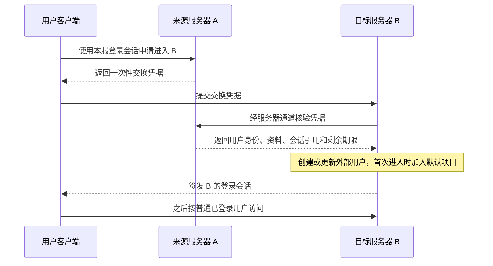

# 服务器互信与跨服务器登录

日期：2026-11-22。状态：设计草案，功能尚未实现。
本文只解决一个问题：A、B 互信后，A 的用户无需在 B 注册即可使用 B。
协议字段和参数为建议值，实现前可调整。

## 1. 目标与基本规则

A、B 建立服务器互信后，A 的用户用自己在 A 的登录状态直接进入 B，
体验与访问一台已注册的服务器基本一致。B 不为该用户保存密码，业务数据只在客户端与 B 之间传输。

基本规则：

- 互信是服务器级的身份信任。B 信任 A 对其本服用户的身份和登录资格的声明；A 的管理员可以改变谁具备该资格。
  B 应只与管理方可信的服务器配对。互信本身不授予 B 的管理权限或项目权限。
- A 决定谁可以从 A 登录 B；B 决定是否接收 A 的登录，以及这些用户登录后能做什么。
  不另设跨服项目权限，也不交换用户目录或项目权限表。
- 跨服凭据只用于一次登录交换。交换成功后 B 签发自己的登录会话，后续业务请求与本服用户走同一条路径。
- B 上的会话不超过 A 的登录会话期限；A 侧退出、停用或撤销会通知 B，并由会话复核兜底。
- 登录方向分别配置，且不可传递：A 的用户不能借 B 的外部账号再进入 C。

## 2. 服务器配对与连接

配对由双方管理员完成，确认对方的稳定 Server ID 并证明持有相应私钥。
复用现有 Spool Relay 的服务器身份密钥和由公钥派生 Server ID 的方式，但无需开启 Relay 才能配对。
双方各自保存对方的公钥、服务器间连接配置、关系状态和允许的登录方向。
名称、DNS、IP 和 Relay 地址只用于显示或路由；公钥变化需要管理员重新确认，不能仅凭名称或地址恢复旧关系。

### 2.1 复用三种传输方式

服务器间通信可以复用 [Desktop 三种连接方式](desktop-servers.zh-CN.md) 的底层传输，
但 Desktop 保存的是设备自己的出站配置；服务器配对后，各服务进程使用自己保存的连接配置，
不依赖某台 Desktop 在线，也不共用客户端的配对或登录凭据。

| 方式 | 服务器间可复用的部分 | 需要新增或配置的部分 |
| --- | --- | --- |
| Public HTTPS | 已有的 HTTPS 入口及反向代理 | 双端用配对密钥认证控制请求和响应；普通 HTTPS 证书不是 Spool 互信证明，普通明文 HTTP 不承载控制请求 |
| Tailscale | 现有 tailnet HTTPS 入口和内嵌 Tailscale 节点 | 服务端接入出站拨号，目标需要在可达的 tailnet 内且 ACL 放行；仍要验证配对的 Spool 身份 |
| Spool Relay | 现有 Relay 隧道、原生拨号及其加密 LAN 快速路径 | 入站服务器启用 Relay，并新增仅限互信控制接口的服务器准入；已有设备批准和 Relay Web 准入不能当成服务器互信 |

控制接口统一要求加密、双向认证及当前关系检查。不必新建一套中继或维持常驻控制连接。
A → B 表示用户登录的方向，**首次交换及会话复核由 B 拨 A**；A → B 的撤销通知是尽力送达，
不要求反向可达才允许单向登录。双方都允许对方的用户登录时，两边都需要有可达的入站路线。
如双方都在 NAT 后，可用 ACL 放行的 Tailscale，或通过目标服务器现有的 Relay 出站隧道接入，不必开放公网端口。

客户端访问 B 可以采用与服务器间控制请求不同的线路，例如 Desktop 经 Relay 访问 B，B 经 Tailscale 核验 A。
客户端仍须按所选线路满足 B 的设备或网络准入条件。跨服登录只免注册 B 的用户账号，
不跳过 Desktop 添加服务器、Relay 设备批准或 Tailscale 网络准入。首版选通一条可用的控制路线即可，
不要求同时发布三种入口，也不因身份验证或授权失败而换线重试。

## 3. 登录资格与 B 的用户管理

| 管理方 | 配置和生效规则 |
| --- | --- |
| A 的管理员 | 针对目标 B 选择允许登录的本服用户。建议默认无人，显式选人；也可明确选择允许所有未停用的本服用户。A 在签发和核验交换凭据时都检查当前资格。 |
| B 的管理员 | 按来源开启或关闭跨服登录，配置首次加入的默认项目和访问级别。开启后，A 核验通过的用户无需在 B 逐一审批或预建账号；B 仍能停用单个用户并调整其项目权限。 |

**A 放行代表用户有资格登录，不代表用户已经获得 B 的项目权限。** B 的默认项目可以为空，此时用户可以登录、
但看不到项目。有默认项目时，首次成功登录就按 B 的设置分配，无需管理员逐个操作。
默认设置只作用于首次分配；以后重新登录不补回被 B 移除的项目，也不覆盖 B 的停用状态或访问级别。

例如：A 只允许李四登录 B；B 接收 A 的登录，并默认把新用户加入「支持」项目。李四首次登录时自动加入；
B 后来把李四移出该项目，李四仍可登录，但再次登录不会恢复成员资格。若 B 停用李四，A 继续放行也不能重新登录。

外部用户在 B 的 `users` 中按首次登录创建带来源标记的记录，以便沿用现有的外键、所有权和可见性查询：

- 身份为 `(来源服务器 ID, 来源用户 ID)`；同一组合始终对应同一条记录，不按昵称、用户名或邮件地址合并。
- 没有本地密码，不能通过 B 的本地登录接口登录，即使输入正确的 A 用户名和密码也不行。
  本地注册和改名不能占用外部账号的内部标识。
- 显示来源昵称、头像和服务器标签，资料在每次登录交换时更新。B 的管理员可按来源识别用户并管理其权限。
- 不获得 B 的管理权限。远程桌面、ADB 桥接等单独配置的主机能力默认关闭，由 B 的管理员按需开启。

项目访问沿用 B 的现有成员、对话、附件和实时事件规则。允许执行 Agent 的成员可以在 B 的环境下执行，
接受 B 与同等权限本服成员相同的执行和审批策略。项目权限不是操作系统级隔离。
B 不向 A 发送项目权限表，也不从 A 预先导入用户列表。

## 4. 登录交换

跨服登录只从**已登录 A 的客户端界面**发起：用户在 A 选择进入已配对的 B，由客户端完成凭据交换并切换到 B。
B 的普通登录页面只用于本服账号，不提供“通过 A 登录”的入口，也不接收 A 的用户名、密码或登录 Cookie。



交换凭据格式：

```text
spool1.<from_server_id>.<random_secret>
```

- `from_server_id` 明文，只帮助 B 从已配对记录中选择核验方；B 不根据凭据或请求中的任何地址选择核验目标。
- `random_secret` 为 32 字节密码学安全随机数。A 只保存哈希，并绑定来源用户、来源登录会话和目标 B。
- 凭据一次性使用，建议 60 秒内有效；A 在确认本服会话、目标 B 和用户登录资格有效后原子消费。凭据只在请求体中提交，不进入 URL、日志或诊断报告。
- 客户端只向配置并验证过的 B 入口提交凭据，不跟随重定向转交凭据。A 从控制请求的已认证身份确认发起方就是 B；
  B 只接受已认证的 A 对本次请求的回复，并确认其中的来源和目标。签发 B 会话前还要检查本地关系与用户是否仍允许登录。

A 的核验回复建议包含：

```json
{
  "active": true,
  "issuer": "server-A",
  "audience": "server-B",
  "subject": "user-123",
  "nickname": "李四",
  "avatar": { "style": "…", "seed": "…" },
  "source_session": "session-reference",
  "session_remaining_seconds": 604800
}
```

期限使用剩余秒数，避免依赖两台服务器的时钟一致。B 按本地发起核验的时间起算剩余期限，
不因网络耗时延长会话。`source_session` 是不可用于登录的引用，仅供后续复核和撤销通知定位会话。

B 签发自己的登录会话，额外记录来源服务器和 `source_session`，期限取 A 的剩余期限与 B 本机会话期限中较短者。
客户端按现有多服务器方式保存和使用 B 的会话，业务请求、长连接和文件传输不携带 A 的凭据。
会话到期后，只有 A 仍在线、A 的登录有效且双方仍允许该用户登录时，客户端才可自动重新交换。

B 对无效凭据使用通用拒绝，按来源地址限流，并短时缓存失败结果，避免未认证请求放大到 A。

## 5. 撤销与复核

| 事件                               | 处理                                                         |
| ---------------------------------- | ------------------------------------------------------------ |
| 用户退出 A，或 A 撤销会话         | A 通知 B 作废对应 `source_session`；自然到期由 B 的本地期限直接生效 |
| A 停用用户或取消其登录 B 的资格   | A 通知 B 作废受影响的会话；B 保留本地用户和项目配置          |
| B 停用外部用户、移出项目           | B 本机立即生效，与本服用户相同，不需要通知 A                 |
| B 关闭来源登录或解除互信           | B 立即作废该来源的全部会话，不影响 A 的本服用户               |
| 定期复核                           | B 只请 A 确认活跃会话是否仍有效、对应用户是否仍可登录 B       |

通知只作废会话，不同步权限，也不能恢复会话。登录交换和复核的旧响应不能覆盖新的作废操作或恢复已关闭的关系。
A 恢复用户的登录资格后，用户需要重新交换；B 不自动恢复 B 管理员撤回的权限。

建议活跃会话每 10 分钟复核一次，空闲会话恢复使用时如已过复核点则按需检查。A 明确答复无效时立即作废；
A 暂时不可达时，已登录用户可继续使用 B，最迟在上次成功核验 24 小时后或 B 会话到期时停止，以先到者为准。
来源不可达与明确撤销返回不同原因，复核失败本身不能延后会话的到期时间。新登录始终要求 B 能联系 A。

因此，A 侧撤销在 B 收到通知后生效；未收到通知时，由下次成功复核或离线期限兜底。B 管理员可直接停用用户
或关闭来源登录，无需等待 A。会话作废和项目权限变更都须覆盖后续实时推送，不能只检查连接建立时的状态。

已发送到设备的数据无法收回；已受理的 Agent 任务在会话作废后继续运行，后续查看需要有效会话。
解除互信后外部用户记录及历史归属保留，标识不分配给其他用户；重新配对后，旧成员关系不得自动恢复，
须由 B 管理员明确确认。

## 6. 逻辑数据

| 数据         | 位置 | 主要内容                                               |
| ------------ | ---- | ------------------------------------------------------ |
| 服务器关系   | A、B | Server ID、公钥、连接配置、关系代次、状态及登录方向    |
| 出站登录资格 | A    | 目标服务器、允许登录的本服用户或明确开启的全员策略     |
| 来源配置     | B    | 是否接受登录、默认项目及访问级别                       |
| 交换凭据     | A    | 凭据哈希、用户、来源会话、目标 B、到期时间、已用标记   |
| 外部用户来源 | B    | 本地用户记录对应的来源服务器 ID 和来源用户 ID          |
| 外部会话来源 | B    | 登录会话对应的来源服务器、`source_session`、上次成功核验时间 |

## 7. 实现前需确认的细节

- 首版优先支持的服务器间传输，以及通过反向代理时如何验证双端控制消息。
- 客户端如何在 A 的已登录界面展示可进入的 B，以及如何复用 B 已保存的连接配置。
- 外部用户内部用户名的格式，以及是否出现在 B 的私信、在线状态和推送中。
- 复核间隔和离线上限的最终数值。A 当前登录会话固定 7 天且无自动续期。

## 8. 验收重点

- 通过已支持的服务器间线路核验双方身份；网络可达、设备已批准或 Relay Web 已开通不等于已互信。
- A 和 B 都放行后，用户无需在 B 注册或输入密码；首次登录建立外部记录并分配 B 配置的默认项目。
- 没有默认项目时可以登录但没有默认项目权限；B 移除成员后重新登录不恢复权限，停用后禁止重新登录。
- 项目权限只由 B 管理，与同等配置的本服成员一致；不交换用户目录或项目权限表。
- 交换凭据不能重复使用，过期、目标不符或由未配对服务器签发时均被拒绝。
- B 的普通登录页面不提供跨服入口，本地登录接口不接受外部账号；跨服登录从已登录的 A 发起。
- 不同来源的同名用户互不影响。
- A 侧退出、停用或取消登录资格后，B 作废受影响的会话；B 停用用户或关闭来源登录不依赖 A。
- A 暂时不可达时不能建立新会话；已登录会话超过离线上限或到期后停止使用。
- 互信不可传递；重新配对不会隐式恢复旧用户的访问。
