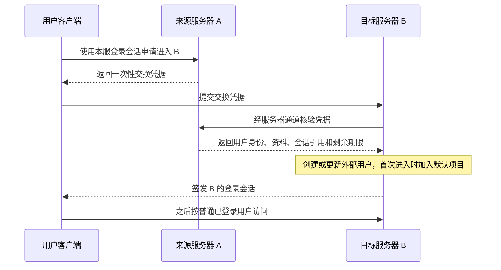

# 服务器互信与跨服务器登录

日期：2026-11-22。
本文只解决一个问题：A、B 互信后，A 的用户无需在 B 注册即可使用 B。

## 1. 目标与基本规则

A、B 建立服务器互信后，A 的用户用自己在 A 的登录状态直接进入 B，
体验与访问一台已注册的服务器基本一致。B 不为该用户保存密码，业务数据只在客户端与 B 之间传输。

基本规则：

- 互信是服务器级的身份信任。B 信任 A 对其本服用户的身份和登录资格的声明；A 的管理员可以改变谁具备该资格。
  B 应只与管理方可信的服务器配对。互信本身不授予 B 的管理权限或项目权限。
- A 决定谁可以从 A 登录 B；B 决定是否接收 A 的登录，以及这些用户登录后能做什么。
  不另设跨服项目权限，也不交换完整用户目录或项目权限表。A 侧人员授权名单及后续变更同步是下一阶段。
- 跨服凭据只用于一次登录交换。交换成功后 B 签发自己的登录会话，后续业务请求与本服用户走同一条路径。
- B 上的会话不超过 A 的登录会话期限；A 侧退出、停用或撤销会通知 B，并由会话复核兜底。
- 登录方向分别配置，且不可传递：A 的用户不能借 B 的外部账号再进入 C。

## 2. 服务器配对与连接

配对由双方管理员完成：A 用 B 提供的线路连接 B，核对身份后提交签名申请；B 审核后，A 沿原线路取回签名回执。
管理员通过可信渠道核对稳定的 Server ID。签名证明持有对应私钥，不替代管理员对对端身份的确认。
复用现有 Spool Relay 的服务器身份密钥和由公钥派生 Server ID 的方式，但无需开启 Relay 才能配对。
一份批准只确认 **A → B** 的授权方向；如需反向授权，由 B 另外发起申请。批准时 B 可选择默认项目和各项目权限；
如果同时配置回连 A 的线路，则允许 B 核验来自 A 的登录。A 默认不放行任何用户，B 不会在首次登录前预建用户或分配项目。
名称、DNS、IP 和 Relay 地址只用于显示或路由；公钥变化需要管理员重新确认，不能仅凭名称或地址恢复旧关系。

### 2.1 复用三种传输方式

服务器间通信可以复用 [Desktop 三种连接方式](desktop-servers.zh-CN.md) 的底层传输，
但 Desktop 保存的是设备自己的出站配置；服务器配对后，各服务进程使用自己保存的连接配置，
不依赖某台 Desktop 在线，也不共用客户端的配对或登录凭据。

| 方式 | 服务器间可复用的部分 | 需要新增或配置的部分 |
| --- | --- | --- |
| Public HTTPS | 已有的 HTTPS 入口及反向代理 | 双端用配对密钥认证控制请求和响应；普通 HTTPS 证书不是 Spool 互信证明，普通明文 HTTP 不承载控制请求 |
| Tailscale | 现有 tailnet HTTPS 入口和内嵌 Tailscale 节点 | 服务端接入出站拨号，目标需要在可达的 tailnet 内且 ACL 放行；仍要验证配对的 Spool 身份 |
| Spool Relay | 现有 Relay 隧道与原生拨号 | 入站服务器启用 Relay；控制请求用配对服务器的客户端证书认证，只能访问控制接口。服务器间线路不走 LAN 快速路径或 Relay Web，也不需要批准客户端设备 |

控制接口统一要求加密、双向认证及当前关系检查。不必新建一套中继或维持常驻控制连接。
A → B 表示用户登录的方向，**首次交换及会话复核由 B 拨 A**；A → B 的撤销通知是尽力送达，
不要求反向可达才允许单向登录。双方都允许对方的用户登录时，两边都需要有可达的入站路线。
如双方都在 NAT 后，可用 ACL 放行的 Tailscale，或通过目标服务器现有的 Relay 出站隧道接入，不必开放公网端口。

客户端访问 B 可以采用与服务器间控制请求不同的线路，例如 Desktop 经 Relay 访问 B，B 经 Tailscale 核验 A。
客户端仍须按所选线路满足 B 的设备或网络准入条件。跨服登录只免注册 B 的用户账号，
不绕过 Relay 设备批准或 Tailscale 网络准入。首版支持三种服务器间线路；
每个配对关系按部署条件选用一种，无需同时开启三种入口，也不因身份验证或授权失败而换线重试。

## 3. 登录资格与 B 的用户管理

| 管理方 | 配置和生效规则 |
| --- | --- |
| A 的管理员 | 针对目标 B 选择允许登录的本服用户。建议默认无人，显式选人；也可明确选择允许所有未停用的本服用户。A 在签发和核验交换凭据时都检查当前资格。 |
| B 的管理员 | 按来源开启或关闭跨服登录，配置首次加入的默认项目和访问级别。开启后，A 核验通过的用户无需在 B 逐一审批或预建账号；B 仍能停用单个用户并调整其项目权限。 |

**A 放行代表用户有资格登录，不代表用户已经获得 B 的项目权限。** B 的默认项目可以为空，此时用户可以登录、
但看不到项目。有默认项目时，首次成功登录就按 B 的设置分配，无需管理员逐个操作。
默认设置只作用于首次分配；以后重新登录不补回被 B 移除的项目，也不覆盖 B 的停用状态或访问级别。

例如：A 只允许李四登录 B；B 接收 A 的登录，并默认把新用户加入「支持」项目。李四首次登录时自动加入；
B 后来把李四移出该项目，李四仍可登录，但再次登录不会恢复成员资格。若 B 停用李四，A 继续放行也不能重新登录。

外部用户在 B 的 `users` 中按首次登录创建带来源标记的记录，以便沿用现有的外键、所有权和可见性查询：

- 身份为 `(来源服务器 ID, 来源用户 ID)`；同一组合始终对应同一条记录，不按昵称、用户名或邮件地址合并。
- 没有本地密码，不能通过 B 的本地登录接口登录，即使输入正确的 A 用户名和密码也不行。
  本地注册和改名不能占用外部账号的内部标识。
- 昵称和头像在每次登录交换时从 A 更新。B 的管理员可在 Desktop 的人员管理或 `spool-server user list` 中看到账号来源，并用现有用户和项目管理功能调整权限。
- 不获得 B 的管理权限。远程桌面、ADB 桥接等单独配置的主机能力默认关闭，由 B 的管理员按需开启。

项目访问沿用 B 的现有成员、对话、附件和实时事件规则。允许执行 Agent 的成员可以在 B 的环境下执行，
接受 B 与同等权限本服成员相同的执行和审批策略。项目权限不是操作系统级隔离。
B 不向 A 发送项目权限表，也不从 A 预先导入用户列表。

## 4. 登录交换

Desktop 和 Android 把每个已登录来源允许访问的互信服务器排在该来源标签后面，并加上互信标识。
切换到 C 时这些分组仍然可见。如果 A 和 D 都允许访问 B，A 和 D 后面各有一个 B 入口，但两个入口复用同一个 B 连接。
点击 A 后面的 B 只使用 A 的账号，点击 D 后面的 B 只使用 D 的账号，不从当前页面或其他服务器猜测来源。B 已有有效会话则优先复用。

A 保存放行人员后，通过现有工作区 WebSocket 通知在线客户端，连接或重连时也会发送当前列表。
撤销或退出 A 会移除 A 提供的互信入口，不影响 D 的入口，也不删除已保存的 B 连接。更新列表不会签发登录票据。
若点击的是没有来源的普通 B 标签，只有 B 明确返回未登录且恰有一个有效账号获准访问时，客户端才自动使用该来源。
若有多个候选，或暂时无法核对候选，则显示 B 的普通登录页；可以直接点击所需来源后面的 B，不必先切回来源。
应用启动、后台刷新和退出登录本身不会触发交换。
Desktop 用钥匙代替状态圆点标识互信标签；已保存目标沿用其档案的连接状态。未保存的公开 HTTPS 目标会在后台匿名核对服务器 ID 和可达性，
不创建档案、不发送 Cookie 或票据，也不经代理、重定向或私网访问目标。匿名探测成功只表示可达，不表示已登录；未配置线路或未保存的 Tailscale 目标显示未连接。
B 的普通登录页面只用于本服账号，不提供“通过 A 登录”的入口，也不接收 A 的用户名、密码或登录 Cookie。

连接 B 优先复用本机已有的连接配置；如果尚未配置，可以使用配对记录中客户端可达的 `client_url`，
确认后将 B 添加到本机。`client_mode: "tailscale"` 表示客户端应通过 Tailscale 访问这个 HTTPS 源地址；
省略时按普通 HTTPS（含 Relay Web）处理，不从服务器间的 `transport` 推断客户端连接方式。
Android 不支持自动添加带路径的 Relay Web 地址；若只提供这种地址，请先在 Android 上给 B 添加原生 Relay 连接。
授权列表只发送客户端 URL 及其连接方式，不发送私用服务器控制线路、Relay 路由码或设备凭据。
客户端必须先核对 B 的身份再发送票据；B 若已有有效的本机登录会话，则继续使用该会话，不覆盖原账号。



交换凭据格式：

```text
spool1.<from_server_id>.<random_secret>
```

- `from_server_id` 明文，只帮助 B 从已配对记录中选择核验方；B 不根据凭据或请求中的任何地址选择核验目标。
- `random_secret` 为 32 字节密码学安全随机数。A 只保存哈希，并绑定来源用户、来源登录会话和目标 B。
- 凭据一次性使用，最多 60 秒有效；A 在确认本服会话、目标 B 和用户登录资格有效后原子消费。凭据只在请求体中提交，不进入 URL、日志或诊断报告。
- 客户端只向配置并验证过的 B 入口提交凭据，不跟随重定向转交凭据。A 从控制请求的已认证身份确认发起方就是 B；
  B 只接受已认证的 A 对本次请求的回复，并确认其中的来源和目标。签发 B 会话前还要检查本地关系与用户是否仍允许登录。

A 的核验回复绑定来源、目标和本次请求。核验成功时回复本服用户 ID、昵称、头像、会话引用和剩余有效时间。
会话期限使用剩余毫秒数，避免因两台服务器的时钟偏差延长会话。B 按本地发起核验的时间起算剩余期限，
不因网络耗时延长会话。`source_session` 是不可用于登录的引用，仅供后续复核和撤销通知定位会话。

B 签发自己的登录会话，额外记录来源服务器和 `source_session`，期限取 A 的剩余期限与 B 本机会话期限中较短者。
客户端按现有多服务器方式保存和使用 B 的会话，业务请求、长连接和文件传输不携带 A 的凭据。
B 的会话到期后，再次选择 B 时可以重新交换。重新登录要求 A 在线、A 的会话有效且双方仍允许该用户登录。

B 对无效凭据使用通用拒绝，按来源地址限流，并短时缓存失败结果，避免未认证请求放大到 A。

## 5. 撤销与复核

| 事件                               | 处理                                                         |
| ---------------------------------- | ------------------------------------------------------------ |
| 用户退出 A，或 A 撤销会话         | A 通知 B 作废对应 `source_session`；自然到期由 B 的本地期限直接生效 |
| A 停用用户或取消其登录 B 的资格   | A 通知 B 作废受影响的会话；B 保留本地用户和项目配置          |
| B 停用外部用户、移出项目           | B 本机立即生效，与本服用户相同，不需要通知 A                 |
| B 关闭来源登录或解除互信           | B 立即作废该来源的全部会话，不影响 A 的本服用户               |
| 定期复核                           | B 只请 A 确认活跃会话是否仍有效、对应用户是否仍可登录 B       |

通知只作废会话，不同步权限，也不能恢复会话。登录交换和复核的旧响应不能覆盖新的作废操作或恢复已关闭的关系。
A 恢复用户的登录资格后，用户需要重新交换；B 不自动恢复 B 管理员撤回的权限。

B 约每 10 分钟在后台复核未到期的跨服会话。A 明确答复无效时立即作废；
A 暂时不可达时，已登录用户可继续使用 B，最迟在上次成功核验 24 小时后或 B 会话到期时停止，以先到者为准。
来源不可达与明确撤销返回不同原因，复核失败本身不能延后会话的到期时间。新登录始终要求 B 能联系 A。

因此，A 侧撤销在 B 收到通知后生效；未收到通知时，由下次成功复核或离线期限兜底。B 管理员可直接停用用户
或关闭来源登录，无需等待 A。会话作废和项目权限变更都须覆盖后续实时推送，不能只检查连接建立时的状态。

已发送到设备的数据无法收回；已受理的 Agent 任务在会话作废后继续运行，后续查看需要有效会话。
关闭来源登录会注销会话，但保留外部用户、历史归属及 B 当前配置的项目成员关系。重新开启后需要重新登录，
并按 B 当前的成员关系授权；已经移除的成员关系不会补回。若希望重新审核后才恢复访问，应先停用对应外部账号。

## 6. 逻辑数据

| 数据         | 位置 | 主要内容                                               |
| ------------ | ---- | ------------------------------------------------------ |
| 服务器关系   | A、B | Server ID、公钥、连接配置、关系代次、状态及登录方向    |
| 出站登录资格 | A    | 目标服务器、允许登录的本服用户或明确开启的全员策略     |
| 来源配置     | B    | 是否接受登录、默认项目及访问级别                       |
| 交换凭据     | A    | 凭据哈希、用户、来源会话、目标 B、到期时间、已用标记   |
| 外部用户来源 | B    | 本地用户记录对应的来源服务器 ID 和来源用户 ID          |
| 外部会话来源 | B    | 登录会话对应的来源服务器、`source_session`、上次成功核验时间 |

## 7. 管理服务器互信

### 7.1 申请与审批

Desktop 的入口是 **设置 → 服务器互信**，只管理本机服务。在远端服务器的聊天页面中，请先切回本机标签，再打开设置。
Android 和普通 Web 聊天页不提供管理员审批入口。

1. B 开启「接收在线互信申请」，把可达的 Public HTTPS 地址、Tailscale HTTPS 地址或互信 Relay 接入码中的一种提供给 A。Relay 接入码须私下交接，不是设备邀请。
2. A 在连接方式标签中选择线路，点击「连接并核对服务器」，查看 B 的名称和 Server ID。使用 Tailscale 时，可以先在该标签登录本机节点；出站申请不要求同时开启本机的 Tailscale HTTPS 入口。向 B 的管理员核对身份后，再点击「发送互信申请」。
3. B 点击「刷新申请」，核对 A 的 ID，选择批准或拒绝。批准时可勾选默认项目，并为每个项目分别配置共享会话权限和应用内创建会话权限。可同时指定 B 回连 A 的线路，也可以稍后配置。
4. A 在「已发出的互信申请」中点击「查询审批结果」，沿原线路确认结果。批准后目标移到「已建立信任的服务器」；拒绝则显示结果，不创建关系。B 可关闭接收新申请，A 仍可查询已提交的申请。

在线申请使用独立的 `POST /api/federation/trust`。公网反向代理须转发此路径；Tailscale 使用内嵌节点及 ACL；Relay 使用独立的 TLS 名称，不开放设备、Web 或配对控制路径。申请入口默认关闭，且不授予业务访问。
服务器间自动验证签名申请与审批结果，两者绑定来源和目标，共用 7 天有效期；已建立的信任不随申请过期。此前仅生成了手动申请、尚未建立互信的，请通过在线流程重新提交。
入站收件箱最多接收 256 条待审批申请，每个来源服务器最多一条。批准或拒绝立即释放待审批名额，签名回执保留至原申请过期。
为保证已接收的申请总有回执空间，未过期的入站申请和回执合计达到 1024 条时不接收新申请，不提前删除回执；已提交的申请仍可查询。

无界面部署用 `spool-server federation`。在本机服务停止时，用服务的系统用户及同一个数据目录执行。B 需在 A 探测、发送及查询时运行服务：

| 执行方 | 子命令 | 用途 |
| --- | --- | --- |
| B | `inbox --enable=true` | 开启在线申请接收，然后启动服务 |
| A | `probe --transport https --address <B 的 HTTPS 地址>` | 连接并查看 B 的服务器身份。Tailscale 用 `--transport tailscale`；Relay 用 `--transport relay --route-file <接入码文件>` |
| A | `send` 加上原线路参数和 `--expect <已核对的 B ID>` | 提交绑定到 B 的签名申请 |
| B | `status`、`approve --id <申请 ID> --policy <JSON 文件>` 或 `reject --id <申请 ID>` | 查看并审批；`--policy` 可省略。JSON 支持 `projects`、`transport` 和 `address`；Relay 回连时 `address` 填 A 的互信 Relay 接入码 |
| A | `check --id <申请 ID>` | 按保存的线路取回审批结果 |

Relay 线路由目标服务器运行 `spool-server federation relay-route` 导出。将输出 JSON 中的 `relay_code` 值单独存入仅管理员可读的文件，再用 `--route-file` 传入；不要把整份 JSON 或设备邀请码当作线路。

### 7.2 设置登录策略与线路

审批时设置的默认项目只在 B 本机保存，不随回执发送给 A。获准用户首次登录时自动加入，不需要 B 管理员逐个加人；之后以 B 实际保存的成员权限为准。
批准后，B 可在「服务器互信」的已建立关系中补配或更换回连 A 的线路。保存后开启接收 A 的登录，不改变默认项目、出站人员授权或客户端连接地址；界面只显示是否接受登录，不回显已保存的线路或接入码。
A 在「服务器互信 → 已建立信任的服务器 → 管理放行人员」逐个放行本服用户，或显式放行所有未停用的本服用户（包括以后新增的用户）。该入口只对已确认的出站关系开放。A 核验当前名单，撤销已有会话时向 B 发送会话撤销通知；不向 B 推送整份名单。
A 确认出站回执时，使用申请保存的线路补齐空的控制线路；Public HTTPS 或 Tailscale 申请还可补齐空的客户端 URL 及其方式。已有线路和权限不被回执覆盖。
无界面部署用 `spool-server federation set` 配置人员或补配回连线路。修改时从 `federation list` 取已保存的对端信息写入 JSON，保留其他需要继续生效的字段。
对通过审批建立的新关系，只能配置已批准方向的权限。已有手工配对保持兼容，但 `set` 不再创建新关系。

- 在 A 配置 B：`users` 填允许登录 B 的本服用户 ID 列表，或显式设置 `all_users: true`；
  如果不需要拨回 B 通知撤销，可以不设控制线路、保留 `accept: false`。
  `client_url` 可填设备可达的 B 的 HTTPS 源地址或 B 的 Relay Web 地址，供未保存 B 连接的客户端使用。
  若客户端应通过 Tailscale 访问该 HTTPS 源地址，同一配置中填写 `client_mode: "tailscale"`。
- 在 B 配置 A：设置 `accept: true`，并按下表提供 B 核验 A 的线路。
  可选的 `projects` 是 B 的首次加入规则，每项填 B 的项目 `id`、`access`（`read-only` 或 `control`）
  和 `own_access`（`read-only` 或 `create`）。

| `transport` | 线路配置 |
| --- | --- |
| `https` | `address` 填 A 的公网 HTTPS 源地址。反向代理须按 [Web 部署指南](deployment.zh-CN.md) 配置受信转发头并转发控制路径。 |
| `tailscale` | `address` 填 A 的 Tailscale HTTPS 源地址。A 和 B 的内嵌节点均需在线，目标 MagicDNS 主机须在 B 的节点视图中，ACL 须允许访问。 |
| `relay` | 在 A 启用 Spool Relay，用 `spool-server federation relay-route` 导出 `relay_code`，私下交给 B 的管理员保存。该码不是设备邀请；Relay 接入令牌轮换后需更新。 |

如果本机已有可用的内嵌 Tailscale 登录状态，服务重启后会按已保存的 Tailscale 控制线路或未过期的出站申请恢复出站拨号，即使本机的 Tailscale HTTPS 入口未开启。客户端的 `client_mode` 不会启动服务端拨号或开放入口。

用 `spool-server federation set --file <配置文件>` 保存完整策略；再次执行会替换该对端的旧设置。
`spool-server federation list` 查看配对。要禁用双向登录，保存 `accept: false`、`all_users: false` 和空 `users`；
已有会话按第 5 节作废，保留项目成员配置。CLI 只配置服务端，不提供用户登录操作。

## 8. 验收重点

- 通过已支持的服务器间线路核验双方身份；网络可达、设备已批准或 Relay Web 已开通不等于已互信。
- A 和 B 都放行后，用户无需在 B 注册或输入密码；首次登录建立外部记录并分配 B 配置的默认项目。
- 没有默认项目时可以登录但没有默认项目权限；B 移除成员后重新登录不恢复权限，停用后禁止重新登录。
- 项目权限只由 B 管理，与同等配置的本服成员一致；不交换用户目录或项目权限表。
- 交换凭据不能重复使用，过期、目标不符或由未配对服务器签发时均被拒绝。
- Desktop 和 Android 在 C 页面仍展示 A 和 D 各自获准的互信入口。点击某组内的 B 只使用该组来源，且不覆盖 B 的有效会话。
- 撤销 A 的访问资格实时移除 A 后面的 B 标签，保留 D 后面的 B 标签和已保存的 B 连接。
- 从 C 点击没有来源的普通 B 标签，若 B 明确未登录且恰有一个有效来源，客户端才自动使用该来源。
- B 的普通登录页面不提供跨服入口，本地登录接口不接受外部账号。
- 不同来源的同名用户互不影响。
- A 侧退出、停用或取消登录资格后，B 作废受影响的会话；B 停用用户或关闭来源登录不依赖 A。
- A 暂时不可达时不能建立新会话；已登录会话超过离线上限或到期后停止使用。
- 互信不可传递；重新开启来源登录不会恢复旧会话或被撤销的 B 侧权限。
